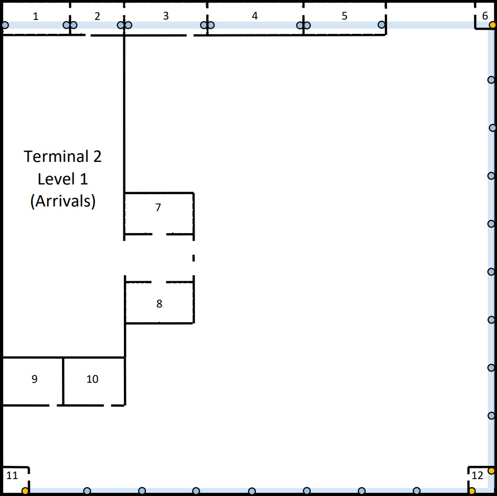
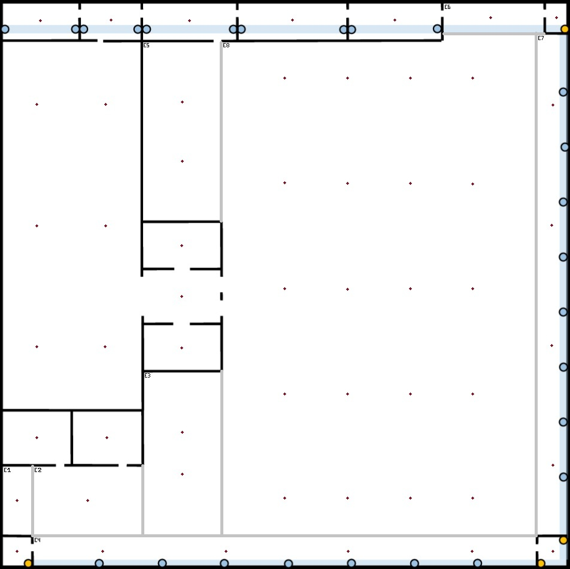
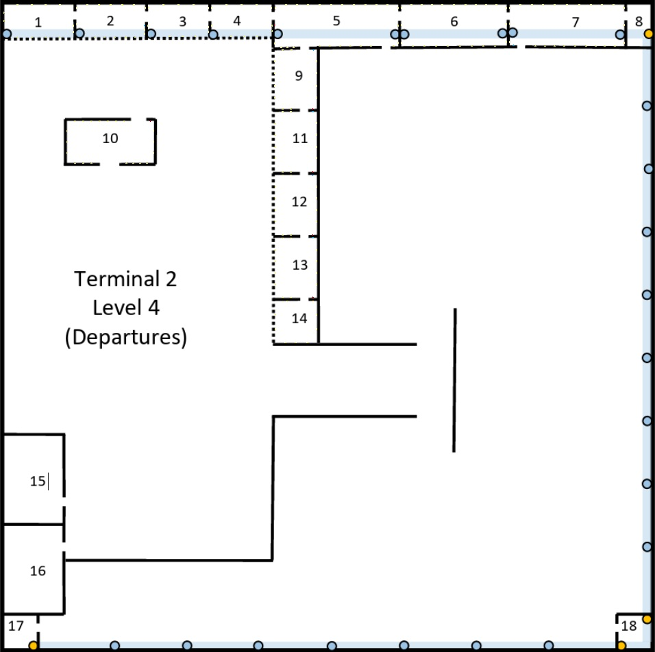
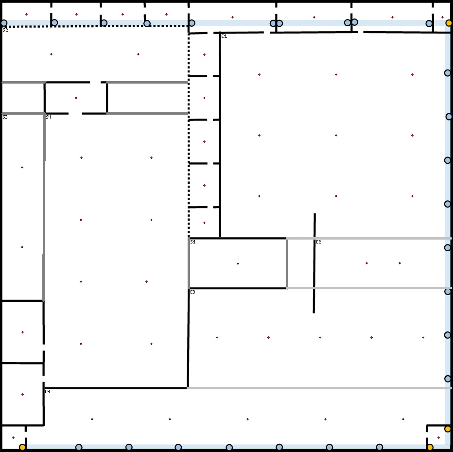
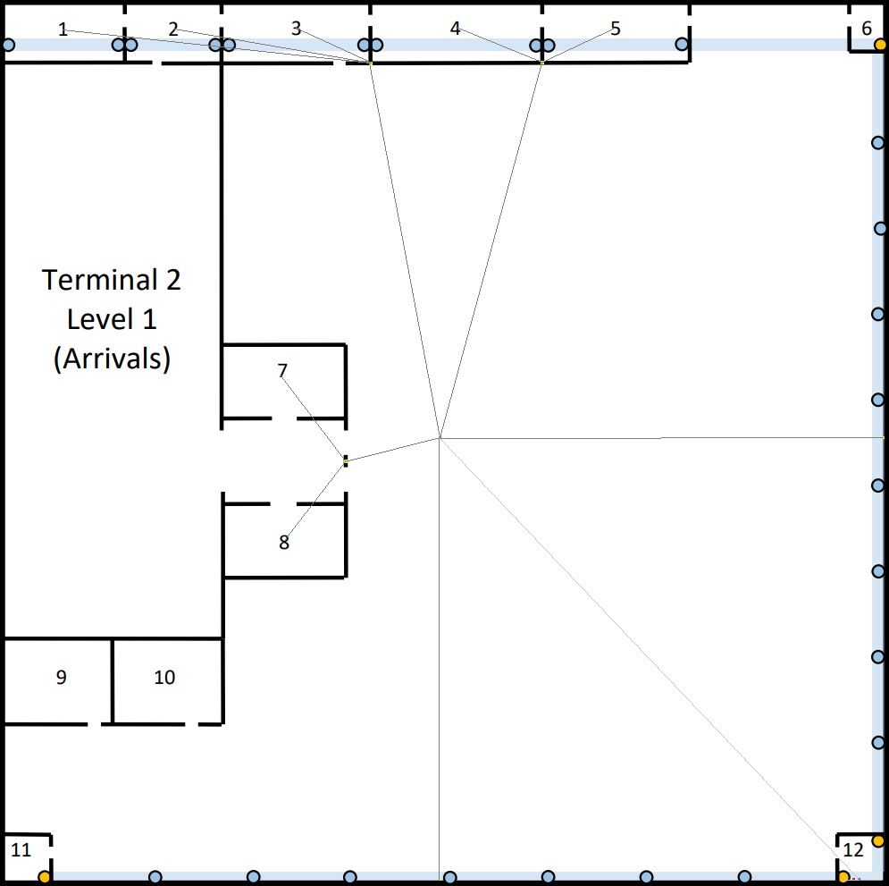
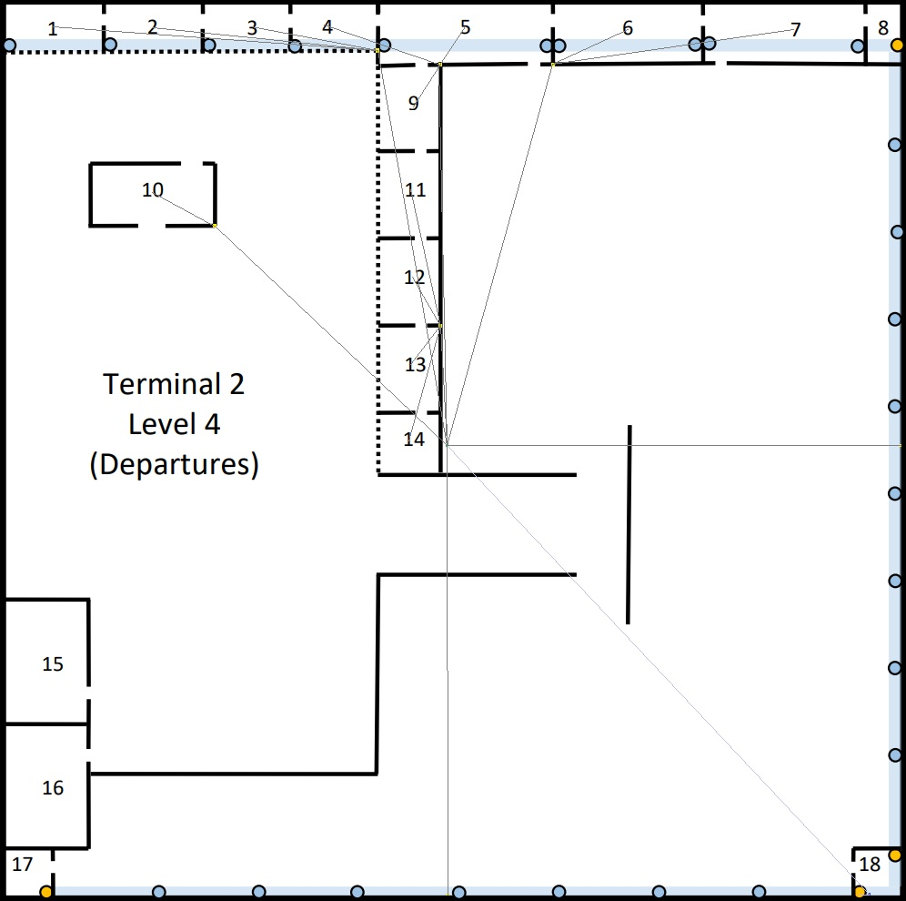

# Terminal 2

---

## 1. Measurements

* **Building Dimensions:** $200m \times 200m = 40000m^2$

---

## 2. Network Outlet Calculations

**Standard Rule:** 2 outlets every 10$m^2$ → `outlets = area / 10 × 2`
> When calculating "(area / 10)", the result will always be
> rounded **up** to ensure full area coverage.

--- 

### 2.1. Level 1 (Arrivals)

> Rooms **with** standard outlets : 1, 2, 3, 4, 5, 7, 8  
> Rooms **without** outlets : 6, 9, 10, 11, 12

---

#### 2.1.1. Room Areas & Outlet Calculations

| Room | Length ($m$) | Width ($m$) | Area ($m^2$) | Outlets | 
|------|--------------|-------------|--------------|---------|
| 1    | 27.3         | 10.6        | 289.38       | 58      | 
| 2    | 22.7         | 10.6        | 240.62       | 49      |
| 3    | 33.3         | 10.6        | 352.98       | 71      |
| 4    | 37.9         | 10.6        | 401.74       | 81      |
| 5    | 30.3         | 10.6        | 321.18       | 65      |
| 7    | 28.8         | 15.1        | 434.88       | 87      |
| 8    | 28.8         | 16.7        | 480.96       | 97      |

**Total Standard outlets for Level 1: 508**

---

#### 2.1.2. External Wall

> As stated on the project requirements, there must be 1 outlet every 5 meters along the **right** and **bottom**
> external walls of Level 1.

| Wall   | Real Length ($m$) | Outlets (length / 5) |
|--------|-------------------|----------------------|
| Right  | 200               | **40**               |
| Bottom | 200               | **40**               |

**Total standard outlets for external walls on Level 1: 80**
**Total standard outlets for Level 2: 588**

---

#### 2.1.3. Access Points Calculations and Positions

> Access Points need to be calculated for each room, individually.  
> For that, we can use an adaptation of the Pythagorean theorem, such as, as all the rooms have a rectangular shape:
> $Length^2 \times Width^2 \leq Diameter^2$
>
> **First Equation Member:** Room Measurements  
> **Second Equation Member:** AP Diameter
>
> If the condition above turns out **true**, it means that an AP in the middle of the room is enough for full
> coverage.  
> Otherwise, some other calculations need to be made.

---

##### APs needed per room

**Diameter Squared of AP:** 2500

| Room | Length ($m$) | Width ($m$) | $Length^2 \times Width^2$ | AP Quantity |
|------|--------------|-------------|---------------------------|-------------|
| 1    | 27.3         | 10.6        | 857.65                    | 1           |
| 2    | 22.7         | 10.6        | 627.65                    | 1           |
| 3    | 33.3         | 10.6        | 1221.25                   | 1           |
| 4    | 37.9         | 10.6        | 1548.77                   | 1           |
| 5    | 30.3         | 10.6        | 1030.45                   | 1           |
| 6    | 7.4          | 10.1        | 156.77                    | 1           |
| 7    | 28.8         | 15.1        | 1057.45                   | 1           |
| 8    | 28.8         | 16.7        | 1108.33                   | 1           |
| 9    | 24.0         | 18.3        | 910.89                    | 1           |
| 10   | 24.0         | 18.3        | 910.89                    | 1           |
| 11   | 10.1         | 10.1        | 204.02                    | 1           |
| 12   | 10.5         | 10.1        | 212.26                    | 1           |

---

> Other than the predefined rooms, I've divided the remaining of the floor in three distinct spaces.  
> **1.** Space between rooms 7 and 8, with the exact same length of these rooms.  
> **2.** Space between rooms on the far left of the floor (1 & 2 --> 9 & 10).  
> **3.** Remaining of the floor
>
> All the above spaces (except for Space 3) are shown in the schematic
> (labeled as "S$x$", where $x$ is the number of the space)

---

| Space | Length ($m$) | Width ($m$) | $Length^2 \times Width^2$ | AP Quantity |
|-------|--------------|-------------|---------------------------|-------------|
| 1     | 28.8         | 18.3        | 1164.33                   | 1           |
| 2     | 49.1         | 129.5       | 19181.06                  | 6           |

---

**Extra Calculations for Space 2 AP Amount**

* To calculate the amount of APs needed for this space we will follow some rules.
* **1.** If some measurement is less than 90% of 50$m$ (around 45$m$) we can fill the room with only one line of APs.
  Otherwise, we should add one extra line;
* **2.** To get the number of lines needed we can use the formula: $n = H \div diameter$;
* **3.** The first APs to be placed must be the ones that cover the corners;
*
* As the space length is less than the AP diameter but greater than 45$m$ we will add two lines of APs to optimize
  space.
* Making $49.1 \div 4$ we get the distance the outside lines must have from the wall, which is 12.28$m$
* With that, we can calculate the maximum $y$ distance the first and last APs should be placed from the wall.  
* $y = \sqrt{25^2 - 12.28^2} = 21.78m$
* **Maximum distance between 2 APs:** $2 * y = 43.56m$
* **Between First and Last APs of a line:** $85.94 \div 43.56 = 1.97$, which means that we need 1 more APs per line

> **Note:** As **Space 3** is not in a rectangular shape we can't apply the same logic.

**Calculations for Space 3**

> In order to make the calculation of Space 3 APs, we proceeded with its
> division in multiple rectangular shaped subspaces
> (shown in the schematic as "E$x$", with $x$ being the number given to the subspace).

---

| Subspace | Length ($m$) | Width ($m$) | $Length^2 \times Width^2$ | AP Quantity |
|----------|--------------|-------------|---------------------------|-------------|
| 1        | 24.0         | 9.9         | 674.01                    | 1           |
| 2        | 24.0         | 37.9        | 2012.41                   | 1           |
| 3        | 56.8         | 26.7        | 3939.13                   | 2           |
| 4        | 9.7          | 176.6       | 31281.65                  | 4           |
| 5        | 62.7         | 26.7        | 4644.18                   | 2           |
| 6        | 10.3         | 33.1        | 1201.7                    | 1           |
| 7        | 175.6        | 10.5        | 30945.61                  | 4           |
| 8        | 173.1        | 109.5       | 41953.86                  | 20          |

---

**Extra Calculations for Subspaces that need more than one AP**

* **E3**  
    * As the subspace width is 26.7$m$, only one line of APs will be needed.  
    * $26.7 \div 2 = 13.35m$, which makes the center of the width of the room.  
    * With that, we can calculate the maximum $x$ distance the first and last APs should be placed from the wall.  
    * $x = \sqrt{25^2 - 13.35^2} = 21.14m$
    * **Maximum distance between 2 APs:** $2 * x = 42.28m$
    * **Between First and Last APs:** $14.52 \div 42.28 = 0.34$, which means no intermediate AP is needed

* **E4**  
    * As the subspace length is 9.7$m$, only one line of APs will be needed.  
    * $9.7 \div 2 = 4.85m$, which makes the center of the length of the room.  
    * With that, we can calculate the maximum $y$ distance the first and last APs should be placed from the wall.  
    * $y = \sqrt{25^2 - 4.85^2} = 24.5m$
    * **Maximum distance between 2 APs:** $2 * y = 49m$
    * **Between First and Last APs:** $127.6 \div 49 = 2.6$, which means that we need 2 more APs for full coverage

* **E5**  
    * As the subspace width is 26.7$m$, only one line of APs will be needed.  
    * $26.7 \div 2 = 13.35m$, which makes the center of the width of the room.  
    * With that, we can calculate the maximum $x$ distance the first and last APs should be placed from the wall.  
    * $x = \sqrt{25^2 - 13.35^2} = 21.14m$
    * **Maximum distance between 2 APs:** $2 * x = 42.28m$
    * **Between First and Last APs:** $20.42 \div 42.28 = 0.48$, which means no intermediate AP is needed

* **E7**  
    * As the subspace width is 10.5$m$, only one line of APs will be needed.  
    * $10.5 \div 2 = 5.25m$, which makes the center of the width of the room.  
    * With that, we can calculate the maximum $x$ distance the first and last APs should be placed from the wall.  
    * $x = \sqrt{25^2 - 5.25^2} = 24.44m$
    * **Maximum distance between 2 APs:** $2 * x = 48.88m$
    * **Between First and Last APs:** $126.72 \div 48.88 = 2.59$, which means that we need 2 more APs for full coverage

* **E8**  
    * As both measurements are greater than 45$m$, we will need more than one line of APs.
    * As the subspace length is 173.1$m$, and $173.1 \div 50 = 3.5$, we will need 4 lines of APs
    * If we make $173.1 \div 8$, we get the distance the outside lines must have from the wall, which is 21.64$m$
    * With that, we can calculate the maximum $y$ distance the first and last APs should be placed from the wall.  
    * $y = \sqrt{25^2 - 21.64^2} = 12.52m$
    * **Maximum distance between 2 APs:** $2 * y = 25.04m$
    * **Between First and Last APs of a line:** $84.46 \div 25.04 = 3.37$, which means that we need 3 more APs per line

---

##### APs Positions

| AP   | X ($m$) | Y ($m$) |
|------|---------|---------|
| AP1  | 13.33   | 6.35    |
| AP2  | 38.52   | 6.35    |
| AP3  | 66.24   | 6.35    |
| AP4  | 102.65  | 6.35    |
| AP5  | 138.84  | 6.35    |
| AP6  | 195.98  | 5.08    |
| AP7  | 63.49   | 86.14   |
| AP8  | 63.49   | 122.12  |
| AP9  | 12.06   | 153.86  |
| AP10 | 36.83   | 153.86  |
| AP11 | 5.08    | 194.07  |
| AP12 | 194.71  | 194.07  |
| AP13 | 63.49   | 103.92  |
| AP14 | 12.28   | 35.98   |
| AP15 | 12.28   | 78.94   |
| AP16 | 12.28   | 121.69  |
| AP17 | 36.61   | 35.98   |
| AP18 | 36.61   | 78.94   |
| AP19 | 36.61   | 121.69  |
| AP20 | 5.08    | 176.08  |
| AP21 | 30.05   | 176.08  |
| AP22 | 63.7    | 151.96  |
| AP23 | 63.7    | 166.77  |
| AP24 | 35.34   | 194.07  |
| AP25 | 79.15   | 194.07  |
| AP26 | 122.33  | 194.07  |
| AP27 | 166.14  | 194.07  |
| AP28 | 63.7    | 34.92   |
| AP29 | 63.7    | 56.08   |
| AP30 | 174.81  | 5.08    |
| AP31 | 194.71  | 35.98   |
| AP32 | 194.71  | 78.73   |
| AP33 | 194.71  | 121.27  |
| AP34 | 194.71  | 163.6   |
| AP35 | 99.89   | 26.67   |
| AP36 | 99.89   | 64.13   |
| AP37 | 99.89   | 101.16  |
| AP38 | 99.89   | 138.41  |
| AP39 | 99.89   | 175.24  |
| AP40 | 122.12  | 26.67   |
| AP41 | 122.12  | 64.13   |
| AP42 | 122.12  | 101.16  |
| AP43 | 122.12  | 138.41  |
| AP44 | 122.12  | 175.24  |
| AP45 | 144.34  | 26.67   |
| AP46 | 144.34  | 64.13   |
| AP47 | 144.34  | 101.16  |
| AP48 | 144.34  | 138.41  |
| AP49 | 144.34  | 175.24  |
| AP50 | 166.35  | 26.67   |
| AP51 | 166.35  | 64.13   |
| AP52 | 166.35  | 101.16  |
| AP53 | 166.35  | 138.41  |
| AP54 | 166.35  | 175.24  |

---

#### 2.1.4. Schematic Plans

##### Outlets

> This schematic shows an example layout for the outlets on the Level. The plan **is not** drawn to scale, as doing so
> would make the diagram too difficult to read.
>
> When placing the outlets, no point in each room can be more than 3 meters away from one.
>
> **Yellow** represents **4** outlets, **Red** represents **2** outlets and **Blue** represents 1 outlet.  
> For clarity reasons the wall outlets won't be placed on the schematic.

  
**(For clarity, outlets associated with Access Points will be shown on a separate schematic)**

##### Access Points

> This floor requires LAN coverage (Wi-Fi).
>
> Each Access Point covers a circle of 50$m$ diameter.  
> All APs will be installed in the space above the dropped ceiling.  
> Each AP will require **a dedicated outlet**.  
> All APs on this terminal will operate on **5GHz band**, since this band offers a much larger number of available
> channels,
> and it also has **DFS (Dynamic Frequency Selection)**, which selects a channel in order avoid interference with its
> neighbours.
>
> This schematic shows how to place the APs and their Dedicated Outlets. Because each level requires 16 APs in the exact
> same positions, this schematic applies to all levels.

---

### 2.2. Level 4 (Departures)

> Rooms **with** standard outlets : 1, 2, 3, 4, 5, 7, 9, 10, 11, 12, 13, 14  
> Rooms **without** outlets : 8, 15, 16, 17, 18

---

#### 2.2.1. Room Areas & Outlet Calculations

| Room | Length ($m$) | Width ($m$) | Area ($m^2$) | Outlets | 
|------|--------------|-------------|--------------|---------|
| 1    | 20.95        | 11.4        | 238.83       | 48      | 
| 2    | 26.7         | 11.4        | 304.38       | 61      |
| 3    | 19.05        | 11.4        | 217.17       | 44      |
| 4    | 19.05        | 11.4        | 217.17       | 44      |
| 5    | 38.1         | 13.3        | 506.73       | 102     |
| 6    | 34.3         | 13.3        | 456.19       | 92      |
| 7    | 36.2         | 13.3        | 481.46       | 97      |
| 9    | 13.3         | 19.05       | 253.37       | 51      |
| 10   | 26.7         | 15.2        | 405.84       | 82      |
| 11   | 13.3         | 19.05       | 253.37       | 51      |
| 12   | 13.3         | 19.05       | 253.37       | 51      |
| 13   | 13.3         | 19.05       | 253.37       | 51      |
| 14   | 13.3         | 13.3        | 176.89       | 36      |

**Total Standard outlets for Level 4: 810**

---

#### 2.2.2. External Wall

> As stated on the project requirements, there must be 1 outlet every 5 meters along the **right** and **bottom**
> external walls of Level 4.

| Wall   | Real Length ($m$) | Outlets (length / 5) |
|--------|-------------------|----------------------|
| Right  | 200               | **40**               |
| Bottom | 200               | **40**               |

**Total standard outlets for external walls on Level 4: 80**
**Total standard outlets for Level 2: 890**

---

#### 2.2.3. Access Points Calculations and Positions

> Access Points need to be calculated for each room, individually.  
> For that, we can use an adaptation of the Pythagorean theorem, such as:
> $Length^2 \times Width^2 \leq Diameter^2$
>
> **First Equation Member:** Room Measurements  
> **Second Equation Member:** AP Diameter
>
> If the condition above turns out **true**, it means that an AP in the middle of the room is enough for full
> coverage.  
> Otherwise, some other calculations need to be made.

---

##### APs needed per room

**Diameter Squared of AP:** 2500

| Room | Length ($m$) | Width ($m$) | $Length^2 \times Width^2$ | AP Quantity | 
|------|--------------|-------------|---------------------------|-------------|
| 1    | 20.95        | 11.4        | 568.86                    | 1           | 
| 2    | 26.7         | 11.4        | 842.85                    | 1           |
| 3    | 19.05        | 11.4        | 492.86                    | 1           |
| 4    | 19.05        | 11.4        | 492.86                    | 1           |
| 5    | 38.1         | 13.3        | 1628.5                    | 1           |
| 6    | 34.3         | 13.3        | 1353.38                   | 1           |
| 7    | 36.2         | 13.3        | 1487.33                   | 1           |
| 8    | 7.17         | 13.3        | 228.3                     | 1           |
| 9    | 13.3         | 19.05       | 539.79                    | 1           |
| 10   | 26.7         | 15.2        | 943.93                    | 1           |
| 11   | 13.3         | 19.05       | 539.79                    | 1           |
| 12   | 13.3         | 19.05       | 539.79                    | 1           |
| 13   | 13.3         | 19.05       | 539.79                    | 1           |
| 14   | 13.3         | 13.3        | 353.78                    | 1           |
| 15   | 26.7         | 18.04       | 1038.33                   | 1           |
| 16   | 27.0         | 18.04       | 1054.44                   | 1           |
| 17   | 10.0         | 10.0        | 200.00                    | 1           |
| 18   | 9.35         | 10.0        | 187.42                    | 1           |

---

> Other than the predefined rooms, I've divided the remaining of the floor in three distinct spaces.  
> **1.** Corridor right below room 14.  
> **2.** Space above room 10.  
> **3.** Space to the bottom left of room 10.  
> **4.** Space right below and to bottom right of room 10.  
> **5.** Remaining of the floor.
>
> All the above spaces (except for Space 5) are shown in the schematic
> (labeled as "S$x$", where $x$ is the number of the space).
>
> NOTE: The spaces on the sides of room 10 won't be calculated as
> their size will be covered by the APs of the spaces around.

---

| Space | Length ($m$) | Width ($m$) | $Length^2 \times Width^2$ | AP Quantity |
|-------|--------------|-------------|---------------------------|-------------|
| 1     | 21.5         | 42.6        | 2277.01                   | 1           |
| 2     | 23.9         | 83.0        | 7460.21                   | 2           |
| 3     | 82.6         | 17.8        | 7139.60                   | 2           |
| 4     | 122.0        | 63.3        | 18890.9                   | 8           |

---

> To calculate the amount of APs needed for spaces with more than one AP we will follow some rules.  
> **1.** If some measurement is less than 90% of 50$m$ (around 45$m$) we can fill the room with only one line of APs.
> Otherwise, we should add one extra line;  
> **2.** To get the number of lines needed we can use the formula: $n = H \div diameter$;  
> **3.** The first APs to be placed must be the ones that cover the corners;  

**Extra Calculations for Space 2 AP Amount**

* As the space length is less than 45$m$, only one line of APs will be needed.
* Making $23.9 \div 2$ we get the distance the outside APs must have from the wall, which is 11.95$m$
* With that, we can calculate the maximum $x$ distance the first and last APs should be placed from the wall.  
* $x = \sqrt{25^2 - 11.95^2} = 21.96m$
* **Maximum distance between 2 APs:** $2 * x = 43.92m$
* **Between First and Last APs of a line:** $39.08 \div 43.92 = 0.89$, which means no intermediate AP is needed.

**Extra Calculations for Space 3 AP Amount**

* As the space width is less than 45$m$, only one line of APs will be needed.
* Making $17.8 \div 2$ we get the distance the outside lines must have from the wall, which is 8.9$m$
* With that, we can calculate the maximum $y$ distance the first and last APs should be placed from the wall.  
* $y = \sqrt{25^2 - 8.9^2} = 23.36m$
* **Maximum distance between 2 APs:** $2 * y = 46.72m$
* **Between First and Last APs of a line:** $35.88 \div 46.72 = 0.77$, which means no intermediate AP is needed.

**Extra Calculations for Space 4 AP Amount**

* As both measurements are greater than 45$m$, we will need more than one line of APs.
* As the space width is 63.3$m$, and $63.3 \div 50 = 1.3$, we will need 2 lines of APs
* Making $63.3 \div 4$ we get the distance the outside lines must have from the wall, which is 15.83$m$
* With that, we can calculate the maximum $y$ distance the first and last APs should be placed from the wall.  
* $y = \sqrt{25^2 - 15.83^2} = 19.35m$
* **Maximum distance between 2 APs:** $2 * y = 38.7m$
* **Between First and Last APs of a line:** $83.3 \div 38.7 = 2.15$, which means that we need 2 more APs per line.

> **Note:** As **Space 5** is not in a rectangular shape we can't apply the same logic.

**Calculations for Space 5**

> In order to make the calculation of Space 5 APs, we proceeded with its
> division in multiple rectangular shaped subspaces
> (shown in the schematic as "E$x$", with $x$ being the number given to the subspace).

> **Note:** The space between Space 1 and the wall will not be considered as the AP in Space 1 covers it.

---

| Subspace | Length ($m$) | Width ($m$) | $Length^2 \times Width^2$ | AP Quantity |
|----------|--------------|-------------|---------------------------|-------------|
| 1        | 90.87        | 102.83      | 18831.4                   | 9           |
| 2        | 20.87        | 60.43       | 4087.34                   | 2           |
| 3        | 43.48        | 116.96      | 15570.2                   | 5           |
| 4        | 26.52        | 181.74      | 33732.7                   | 5           |

---

**Extra Calculations for Subspaces that need more than one AP**

* **E1**  
    * As both measurements are greater than 45$m$, we will need more than one line of APs.
    * As the subspace width is 102.83$m$, and $102.83 \div 50 = 2.1$, we will need 3 lines of APs
    * If we make $102.83 \div 6$, we get the distance the outside lines must have from the wall, which is 17.14$m$
    * With that, we can calculate the maximum $y$ distance the first and last APs should be placed from the wall.
    * $y = \sqrt{25^2 - 17.14^2} = 18.2m$
    * **Maximum distance between 2 APs:** $2 * y = 36.4m$
    * **Between First and Last APs of a line:** $54.47 \div 36.4 = 1.5$, which means that we need 1 more APs per line.

* **E2**  
    * As the subspace length is 20.87$m$, only one line of APs will be needed.
    * Making $20.87 \div 2$ we get the distance the outside APs must have from the wall, which is 10.44$m$
    * With that, we can calculate the maximum $x$ distance the first and last APs should be placed from the wall.  
    * $x = \sqrt{25^2 - 10.44^2} = 22.72m$
    * **Maximum distance between 2 APs:** $2 * x = 45.44m$
    * **Between First and Last APs of a line:** $14.99 \div 45.44 = 0.33$, which means no intermediate AP is needed.

* **E3**  
    * As the subspace length is 43.48$m$, only one line of APs will be needed.
    * Making $43.48 \div 2$ we get the distance the outside APs must have from the wall, which is 21.74$m$
    * With that, we can calculate the maximum $x$ distance the first and last APs should be placed from the wall.  
    * $x = \sqrt{25^2 - 21.74^2} = 12.34m$
    * **Maximum distance between 2 APs:** $2 * x = 24.68m$
    * **Between First and Last APs of a line:** $92.28 \div 24.68 = 3.74$, which means that we need 3 more APs.

* **E4**  
    * As the subspace length is 26.52$m$, only one line of APs will be needed.
    * Making $26.52 \div 2$ we get the distance the outside APs must have from the wall, which is 13.26$m$
    * With that, we can calculate the maximum $x$ distance the first and last APs should be placed from the wall.  
    * $x = \sqrt{25^2 - 13.26^2} = 21.19m$
    * **Maximum distance between 2 APs:** $2 * x = 42.38m$
    * **Between First and Last APs of a line:** $139.36 \div 42.38 = 3.29$, which means that we need 3 more APs.

---

##### APs Positions

| AP   | X ($m$) | Y ($m$) |
|------|---------|---------|
| AP1  | 10.87   | 5.22    |
| AP2  | 33.48   | 5.22    |
| AP3  | 54.13   | 5.22    |
| AP4  | 73.7    | 5.22    |
| AP5  | 103.26  | 6.74    |
| AP6  | 139.78  | 6.74    |
| AP7  | 174.78  | 6.74    |
| AP8  | 197.17  | 6.74    |
| AP9  | 90.65   | 23.48   |
| AP10 | 33.26   | 42.83   |
| AP11 | 90.65   | 42.83   |
| AP12 | 90.65   | 62.17   |
| AP13 | 90.65   | 82.0    |
| AP14 | 90.65   | 98.7    |
| AP15 | 9.13    | 147.61  |
| AP16 | 9.13    | 175.43  |
| AP17 | 5.0     | 194.78  |
| AP18 | 195.43  | 194.78  |
| AP19 | 107.83  | 116.96  |
| AP20 | 22.17   | 23.26   |
| AP21 | 61.09   | 23.26   |
| AP22 | 9.13    | 73.91   |
| AP23 | 9.13    | 109.57  |
| AP24 | 35.65   | 69.57   |
| AP25 | 66.96   | 69.57   |
| AP26 | 35.65   | 97.39   |
| AP27 | 66.96   | 97.39   |
| AP28 | 35.65   | 125.0   |
| AP29 | 66.96   | 125.0   |
| AP30 | 35.65   | 152.83  |
| AP31 | 66.96   | 152.83  |
| AP32 | 115.22  | 32.39   |
| AP33 | 149.57  | 32.39   |
| AP34 | 183.7   | 32.39   |
| AP35 | 115.22  | 59.57   |
| AP36 | 149.57  | 59.57   |
| AP37 | 183.7   | 59.57   |
| AP38 | 115.22  | 86.52   |
| AP39 | 149.57  | 86.52   |
| AP40 | 183.7   | 86.52   |
| AP41 | 163.26  | 116.74  |
| AP42 | 178.04  | 116.74  |
| AP43 | 96.3    | 150.0   |
| AP44 | 119.35  | 150.0   |
| AP45 | 142.39  | 150.0   |
| AP46 | 165.43  | 150.0   |
| AP47 | 188.48  | 150.0   |
| AP48 | 40.43   | 186.52  |
| AP49 | 75.22   | 186.52  |
| AP50 | 110.0   | 186.52  |
| AP51 | 144.78  | 186.52  |
| AP52 | 179.57  | 186.52  |

---

#### 2.2.4. Schematic Plans

##### Outlets

> This schematic shows an example layout for the outlets on the Level. The plan **is not** drawn to scale, as doing so
> would make the diagram too difficult to read.
>
> When placing the outlets, no point in each room can be more than 3 meters away from one.
>
> **Yellow** represents **4** outlets, **Red** represents **2** outlets and **Blue** represents 1 outlet.  
> For clarity reasons the wall outlets won't be placed on the schematic.

  
**(For clarity, outlets associated with Access Points will be shown on a separate schematic)**

---

##### Access Points

> This floor requires LAN coverage (Wi-Fi).
>
> Each Access Point covers a circle of 50$m$ diameter.  
> All APs will be installed in the space above the dropped ceiling.  
> Each AP will require **a dedicated outlet**.  
> All APs on this terminal will operate on **5GHz band**, since this band offers a much larger number of available
> channels,
> and it also has **DFS (Dynamic Frequency Selection)**, which selects a channel in order avoid interference with its
> neighbours.
>
> This schematic shows how to place the APs and their Dedicated Outlets. Because each level requires 16 APs in the exact
> same positions, this schematic applies to all levels.

---

## 4. Cross Connections

> Cables connecting an MC to an IC are limited to 1500 meters long.  
> Cables connecting an IC and an HC are limited to 500 meters long.  
> Each enclosure has a size of 42$U$, this means it fits up to 200 cables.  
> An enclosure must have 1$U$ of free space.  
> All HCs will be placed on above the dropped ceiling.  
> By each room there will be a CP, to facilitate cable distribution.

---

### 4.1. Level 1 - HCs & CPs positions & rooms/areas assigned

At this level we will need to place both an MC and an IC.  
As the room dimensions are 200$m$ x 200$m$, the highest distance between two points of the room will be its diagonal.
This has a length of 282.84$m$, which means the IC can be placed in any of the hardware rooms available.  
I've decided to place both in room 12, so it is close to a vertical passageway, and it makes it easier to make a
connection between them.

With this room dimensions we also know that a **singular HC** is necessary, if placed in the middle of the room.

To be able to connect all cables we will need some CPs. For that we will make the following distribution:

- **CP-L1-01** : Placed exactly in the middle of the right side external wall
- **CP-L1-02** : Placed exactly in the middle of the bottom side external wall
- **CP-L1-03** : This CP will be placed at the end of room 3, in order to server rooms 1, 2 and 3 and AP outlets around
  it, if needed.
- **CP-L1-04** : This CP will be placed between rooms 4 and 5, serving these exact rooms and AP outlets around it, if
  needed.
- **CP-L1-05** : This CP will be placed between rooms 7 and 8, serving these exact rooms and AP outlets around it, if
  needed.

All the CPs are less than 90 meters away from the HC, as well as the furthest outlet connecting to them.

| CP       | X ($m$) | Y ($m$) | Rooms served | Outlets | APs | APs served                                      | Total   |
|----------|---------|---------|--------------|---------|-----|-------------------------------------------------|---------|
| CP-L1-01 | 200     | 100     | None.        | 40      | 8   | AP6, AP31-34, AP51-53                           | **48**  |
| CP-L1-02 | 100     | 200     | None.        | 40      | 11  | AP11-12, AP20, AP24-27, AP39, APP44, AP49, AP54 | **51**  |
| CP-L1-03 | 83.3    | 10.6    | R1, R2, R3   | 178     | 5   | AP1-3, AP14, AP17                               | **183** |
| CP-L1-04 | 121.1   | 10.6    | R4, R5       | 146     | 7   | AP4-5, AP30, AP35, AP40, AP45, AP50             | **153** |
| CP-L1-05 | 78.8    | 103.92  | R7, R8       | 184     | 9   | AP7-10, AP15, AP18, AP21-23                     | **193** |

All the remaining APs will be connected directly to the HC, as they are in its range.

**Total: 1 HC + 5 CPs**

--- 

#### 4.1.1. Level 0 - Cable Distance Validation

All distances will be measured on a straight-line from HC or CP to the room center or the AP position.  
In order to the calculations being correct all distances must be below 100$m$.

**CP-L1-01**

All outlets present in the external wall are automatically below a distance of 100$m$,
as the wall size is of 200$m$ total, and the CP is being placed in the middle.

| Connection | Coordinates      | Distance |
|:-----------|:-----------------|:---------|
| **AP6**    | (195.98; 5.08)   | 95.01$m$ |
| **AP31**   | (194.71; 35.98)  | 64.24$m$ |
| **AP32**   | (194.71; 78.73)  | 21.92$m$ |
| **AP33**   | (194.71; 121.27) | 21.92$m$ |
| **AP34**   | (194.71; 163.3)  | 64.24$m$ |
| **AP51**   | (166.35; 64.13)  | 49.18$m$ |
| **AP52**   | (166.35; 101.16) | 33.67$m$ |
| **AP53**   | (166.35; 138.41) | 51.07$m$ |

**CP-L1-02**

All outlets present in the external wall are automatically below a distance of 100$m$,
as the wall size is of 200$m$ total, and the CP is being placed in the middle.

| Connection | Coordinates      | Distance |
|:-----------|:-----------------|:---------|
| **AP11**   | (5.08; 194.07)   | 95.11$m$ |
| **AP12**   | (194.71; 194.07) | 94.90$m$ |
| **AP20**   | (5.08; 176.08)   | 97.89$m$ |
| **AP24**   | (35.34; 194.07)  | 64.93$m$ |
| **AP25**   | (79.15; 194.07)  | 21.68$m$ |
| **AP26**   | (122.33; 194.07) | 23.10$m$ |
| **AP27**   | (166.14; 194.07) | 66.41$m$ |
| **AP39**   | (99.89; 175.24)  | 24.76$m$ |
| **AP44**   | (122.12; 175.24) | 33.20$m$ |
| **AP49**   | (144.34; 175.24) | 50.78$m$ |
| **AP54**   | (166.35; 175.24) | 70.82$m$ |

**CP-L1-03**

| Connection | Coordinates    | Distance |
|:-----------|:---------------|:---------|
| **R1**     | (13.33; 6.35)  | 70.10$m$ |
| **R2**     | (38.52; 6.35)  | 44.98$m$ |
| **R3**     | (66.24; 6.35)  | 17.58$m$ |
| **AP1**    | (13.33; 6.35)  | 70.10$m$ |
| **AP2**    | (38.52; 6.35)  | 44.98$m$ |
| **AP3**    | (66.24; 6.35)  | 17.58$m$ |
| **AP14**   | (12.28; 35.98) | 75.42$m$ |
| **AP17**   | (36.61; 35.98) | 53.14$m$ |

**CP-L1-04**

| Connection | Coordinates     | Distance |
|:-----------|:----------------|:---------|
| **R4**     | (102.65; 6.35)  | 18.93$m$ |
| **R5**     | (138.84; 6.35)  | 18.24$m$ |
| **AP4**    | (102.65; 6.35)  | 18.93$m$ |
| **AP5**    | (138.84; 6.35)  | 18.24$m$ |
| **AP30**   | (174.81; 5.08)  | 54.00$m$ |
| **AP35**   | (99.89; 26.67)  | 26.61$m$ |
| **AP40**   | (122.12; 26.67) | 16.10$m$ |
| **AP45**   | (144.34; 26.67) | 28.25$m$ |
| **AP50**   | (166.35; 26.67) | 48.02$m$ |

**CP-L1-05**

| Connection | Coordinates     | Distance |
|:-----------|:----------------|:---------|
| **R7**     | (63.49; 86.14)  | 23.46$m$ |
| **R8**     | (63.49; 122.12) | 23.78$m$ |
| **AP7**    | (63.49; 86.14)  | 23.46$m$ |
| **AP8**    | (63.49; 122.12) | 23.78$m$ |
| **AP9**    | (12.06; 153.86) | 83.36$m$ |
| **AP10**   | (36.83; 153.86) | 65.23$m$ |
| **AP15**   | (12.28; 78.94)  | 71.06$m$ |
| **AP18**   | (36.61; 78.94)  | 49.03$m$ | 
| **AP21**   | (30.05; 176.08) | 87.08$m$ |
| **AP22**   | (63.7; 151.96)  | 50.36$m$ |
| **AP23**   | (63.7; 166.77)  | 64.64$m$ |

**Remaining APs - Directly to HC**

| Connection | Coordinates      | Distance |
|:-----------|:-----------------|:---------|
| **AP13**   | (63.49; 103.92)  | 36.72$m$ |
| **AP16**   | (12.28; 121.69)  | 90.36$m$ |
| **AP19**   | (36.61; 121.69)  | 67.00$m$ |
| **AP28**   | (63.7; 34.92)    | 74.52$m$ |
| **AP29**   | (63.7; 56.08)    | 56.98$m$ |
| **AP36**   | (99.89; 64.13)   | 35.87$m$ |
| **AP37**   | (99.89; 101.16)  | 1.17$m$  |
| **AP38**   | (99.89; 138.41)  | 38.41$m$ |
| **AP41**   | (122.12; 64.13)  | 42.14$m$ |
| **AP42**   | (122.12; 101.16) | 22.15$m$ |
| **AP43**   | (122.12; 138.41) | 44.32$m$ |
| **AP46**   | (144.34; 64.13)  | 57.03$m$ |
| **AP47**   | (144.34; 101.16) | 44.36$m$ |
| **AP48**   | (144.34; 138.41) | 58.66$m$ |

---

### 4.2. Level 4 - HCs & CPs positions and rooms/areas assigned

At this level we will only need to place an IC.  
As the room dimensions are 200$m$ x 200$m$, the highest distance between two points of the room will be its diagonal.
This has a length of 282.84$m$, which means the IC can be placed in any of the hardware rooms available.  
I've decided to place it in room 18, so it is close to a vertical passageway
and directly above the room with the MC, so the connection is easier.

With this room dimensions we also know that a **singular HC** is necessary, if placed in the middle of the room.

To be able to connect all cables we will need some CPs. For that we will make the following distribution:

- **CP-L4-01** : Placed exactly in the middle of the right side external wall
- **CP-L4-02** : Placed exactly in the middle of the bottom side external wall
- **CP-L4-03** : Placed at the right bottom corner of room 4.
- **CP-L4-04** : Placed at the left bottom corner of room 6.
- **CP-L4-05** : Placed at the right intersection of rooms 5 and 9.
- **CP-L4-06** : Placed between rooms 12 and 13.
- **CP-L4-07** : Placed at the right bottom corner of room 10.

All the CPs are less than 90 meters away from the HC, as well as the furthest outlet connecting to them.

| CP       | X ($m$) | Y ($m$) | Rooms served       | Outlets | APs | APs served                            | Total   |
|----------|---------|---------|--------------------|---------|-----|---------------------------------------|---------|
| CP-L4-01 | 200     | 100     | None.              | 40      | 13  | AP30-31, AP34, AP37, AP40-42, AP47-52 | **53**  |
| CP-L4-02 | 100     | 200     | None.              | 40      | 5   | AP17-18, AP43, AP45-46                | **45**  | 
| CP-L4-03 | 85.75   | 11.4    | R1, R2, R3         | 153     | 3   | AP1-3                                 | **156** |
| CP-L4-04 | 77.67   | 13.3    | R6, R7             | 189     | 2   | AP6-7                                 | **191** |
| CP-L4-05 | 99.05   | 13.3    | R4, R5, R9         | 197     | 3   | AP4-5, AP9                            | **200** |
| CP-L4-06 | 99.05   | 70.45   | R11, R12, R13, R14 | 189     | 11  | AP11-14, AP32-33, AP35-36, AP38-39    | **200** |
| CP-L4-07 | 44.5    | 50.5    | R10                | 82      | 11  | AP10, AP20-29                         | **93**  |

All the remaining APs will be connected directly to the HC, as they are in its range.

**Total: 1 HC + 7 CPs**

---

#### 4.2.1. Level 4 - Cable Distance Validation

All distances will be measured on a straight-line from HC or CP to the room center or the AP position.  
In order to the calculations being correct all distances must be below 100$m$.

**CP-L4-01**

All outlets present in the external wall are automatically below a distance of 100$m$,
as the wall size is of 200$m$ total, and the CP is being placed in the middle.

| Connection | Coordinates      | Distance |
|:-----------|:-----------------|:---------|
| **AP30**   | (35.65; 152.83)  | 79.79$m$ |
| **AP31**   | (66.96; 152.83)  | 57.59$m$ |
| **AP34**   | (183.7; 32.39)   | 69.55$m$ |
| **AP37**   | (183.7; 59.57)   | 43.59$m$ |
| **AP40**   | (183.7; 86.52)   | 21.15$m$ | 
| **AP41**   | (163.26; 116.74) | 40.37$m$ | 
| **AP42**   | (178.04; 116.74) | 27.61$m$ |
| **AP47**   | (188.48; 150.0)  | 51.31$m$ |
| **AP48**   | (40.43; 186.52)  | 61.08$m$ |
| **AP49**   | (75.22; 186.52)  | 28.21$m$ |
| **AP50**   | (110.0; 186.52)  | 16.78$m$ |
| **AP51**   | (144.78; 186.52) | 46.76$m$ |
| **AP52**   | (179.57; 186.52) | 80.70$m$ |

**CP-L4-02**

All outlets present in the external wall are automatically below a distance of 100$m$,
as the wall size is of 200$m$ total, and the CP is being placed in the middle.

| Connection | Coordinates      | Distance |
|:-----------|:-----------------|:---------|
| **AP17**   | (5.0; 194.78)    | 95.14$m$ |
| **AP18**   | (195.43; 194.78) | 95.57$m$ |
| **AP43**   | (96.3; 150.0)    | 50.14$m$ |
| **AP45**   | (142.39; 150.0)  | 65.55$m$ |
| **AP46**   | (165.43; 150.0)  | 82.35$m$ |

**CP-L4-03**

| Connection | Coordinates   | Distance |
|:-----------|:--------------|:---------|
| **R1**     | (10.87; 5.22) | 75.13$m$ |
| **R2**     | (33.48; 5.22) | 52.63$m$ |
| **R3**     | (54.13; 5.22) | 32.22$m$ |
| **AP1**    | (10.87; 5.22) | 75.13$m$ |
| **AP2**    | (33.48; 5.22) | 52.63$m$ |
| **AP3**    | (54.13; 5.22) | 32.22$m$ |

**CP-L4-04**

| Connection | Coordinates    | Distance |
|:-----------|:---------------|:---------|
| **R6**     | (139.78; 6.74) | 41.25$m$ |
| **R7**     | (174.78; 6.74) | 76.01$m$ |
| **AP6**    | (139.78; 6.74) | 41.25$m$ |
| **AP7**    | (174.78; 6.74) | 76.01$m$ |

**CP-L4-05**

| Connection | Coordinates    | Distance |
|:-----------|:---------------|:---------|
| **R4**     | (73.7; 5.22)   | 26.61$m$ |
| **R5**     | (103.26; 6.74) | 7.79$m$  |
| **R9**     | (90.65; 23.48) | 13.20$m$ |
| **AP4**    | (73.7; 5.22)   | 26.61$m$ |
| **AP5**    | (103.26; 6.74) | 7.79$m$  |
| **AP9**    | (90.65; 23.48) | 13.20$m$ |

**CP-L4-06**

| Connection | Coordinates     | Distance |
|:-----------|:----------------|:---------|
| **R11**    | (90.65; 42.83)  | 28.87$m$ |
| **R12**    | (90.65; 62.17)  | 11.79$m$ |
| **R13**    | (90.65; 82.0)   | 14.28$m$ |
| **R14**    | (90.65; 98.7)   | 29.47$m$ |
| **AP11**   | (90.65; 42.83)  | 28.87$m$ |
| **AP12**   | (90.65; 62.17)  | 11.79$m$ |
| **AP13**   | (90.65; 82.0)   | 14.28$m$ |
| **AP14**   | (90.65; 98.7)   | 29.47$m$ |
| **AP32**   | (115.22; 32.39) | 41.35$m$ |
| **AP33**   | (149.57; 32.39) | 63.25$m$ |
| **AP35**   | (115.22; 59.57) | 19.49$m$ |
| **AP36**   | (149.57; 59.57) | 51.68$m$ |
| **AP38**   | (115.22; 86.52) | 22.80$m$ |
| **AP39**   | (149.57; 86.52) | 53.01$m$ |

**CP-L4-07**

| Connection | Coordinates    | Distance |
|:-----------|:---------------|:---------|
| **R10**    | (33.26; 42.83) | 13.61$m$ |
| **AP10**   | (33.26; 42.83) | 13.61$m$ |
| **AP20**   | (22.17; 23.26) | 35.22$m$ |
| **AP21**   | (61.09; 23.26) | 31.89$m$ |
| **AP22**   | (9.13; 73.91)  | 42.42$m$ |
| **AP23**   | (9.13; 109.57) | 68.85$m$ |
| **AP24**   | (36.65; 69.57) | 20.62$m$ |
| **AP25**   | (66.96; 69.57) | 29.46$m$ |
| **AP26**   | (35.65; 97.39) | 47.72$m$ |
| **AP27**   | (66.96; 97.39) | 52.00$m$ |
| **AP28**   | (35.65; 125.0) | 75.02$m$ |
| **AP29**   | (66.96; 125.0) | 77.81$m$ |

**Remaining APs - Directly to HC**

| Connection | Coordinates      | Distance |
|:-----------|:-----------------|:---------|
| **AP19**   | (107.83; 116.96) | 18.68$m$ |
| **AP44**   | (119.35; 150.0)  | 53.61$m$ |

---

## 5. Cable Pathways

> The cable length is calculated by using the straight line between the HC and the room/area it serves.
>
> **MC → IC:** The MC will connect to the IC on both levels.
>
> **IC → HC:** The IC will connect to all HCs on their specific level, using the dropped ceiling.
>
> **Room outlets:** $d_{HC \to room\_center} \times N_{outlets}$ — in order to simplify calculations
>
> **APs (room or open area):** $d_{HC \to AP\_position}$ - since each AP has a dedicated outlet
>
> **Cable Redundancy** will be considered to connect **MC → IC** and **IC → HC**

---

### 5.1. MC → IC (Backbone)

The MC and the IC on Level 1 will be co-located, since both of them will be on Room 12.
We will consider 1$m$ of cable for this connection.  
To connect the MC to the IC on Level 2 (Room 18), we will need to use the vertical passageway to go up 15$m$.

**Total cable length for MC → IC connections: 16$m$**

**Total cable length for MC → IC connections (with cable redundancy): 32$m$**

### 5.2. IC → HC

Since there are 2 ICs, one on each floor, we only need:

| Connection  | Distance  |
|-------------|-----------|
| IC1 → HC-L1 | 133.49$m$ |
| IC4 → HC-L4 | 134.50$m$ |

**Total cable length for IC → HC connections : 267.99$m$**

**Total cable length for IC → HC connections (with cable redundancy) : 535.98$m$**

---

### 5.3. HC → CP

| Connection       | Distance |
|------------------|----------|
| HC-L1 → CP-L1-01 | 100$m$   |
| HC-L1 → CP-L1-02 | 100$m$   |
| HC-L1 → CP-L1-03 | 90.95$m$ |
| HC-L1 → CP-L1-04 | 91.86$m$ |
| HC-L1 → CP-L1-05 | 21.56$m$ |
| HC-L4 → CP-L1-01 | 100$m$   |
| HC-L4 → CP-L1-02 | 100$m$   |
| HC-L4 → CP-L1-03 | 89.74$m$ |
| HC-L4 → CP-L1-04 | 89.53$m$ |
| HC-L4 → CP-L1-05 | 86.71$m$ |
| HC-L4 → CP-L1-06 | 29.57$m$ |
| HC-L4 → CP-L1-07 | 74.37$m$ |

---

### 5.4. HP → Outlet

| CP       | Type                                              | Cables | Total Cable length |
|----------|---------------------------------------------------|--------|--------------------|
| CP-L1-01 | **Wall Outlets**: 1756.4$m$ & **APs**: 401.25$m$  | 48     | 2157.65$m$         |
| CP-L1-02 | **Wall Outlets**: 1756.4$m$ & **APs**: 643.58$m$  | 51     | 2399.98$m$         |
| CP-L1-03 | **Room Outlets**: 7518.0$m$ & **APs**: 261.22$m$  | 183    | 7779.22$m$         |
| CP-L1-04 | **Room Outlets**: 2718.9$m$ & **APs**: 210.15$m$  | 153    | 2929.05$m$         |
| CP-L1-05 | **Room Outlets**: 4347.7$m$ & **APs**: 518.00$m$  | 193    | 4865.70$m$         |
| CP-L4-01 | **Wall Outlets**: 1732.0$m$ & **APs**: 624.49$m$  | 53     | 2356.49$m$         |
| CP-L4-02 | **Wall Outlets**: 1756.2$m$ & **APs**: 388.75$m$  | 45     | 2144.95$m$         |
| CP-L4-03 | **Room Outlets**: 8234.4$m$ & **APs**: 159.98$m$  | 156    | 8394.38$m$         |
| CP-L4-04 | **Room Outlets**: 11168.0$m$ & **APs**: 117.26$m$ | 191    | 11285.3$m$         |
| CP-L4-05 | **Room Outlets**: 2638.6$m$ & **APs**: 47.60$m$   | 200    | 2686.20$m$         |
| CP-L4-06 | **Room Outlets**: 3862.9$m$ & **APs**: 335.99$m$  | 200    | 4198.89$m$         |
| CP-L4-07 | **Room Outlets**: 1116.0$m$ & **APs**: 494.62$m$  | 93     | 1610.62$m$         |

---

#### Schematic Plan (Cable Pathways)

> These schematics show how the MC, ICs, HCs and CPs were placed on both levels.  
> They also show connections between all the components.
>
> **Red** represents the MC, **Blue** the IC, **Green** the HC and **Yellow** the CPs.  
> For the connections **Light Gray** represents Copper Cables, while **Lilac** represents Fibre Cables.
> 
> Note: These schematics don't have the connections of APs, as doing so will make it almost impossible to understand them.

**Level 1 - Cable Schematic**

**Level 4 - Cable Schematic**

---

## 6.Hardware Inventory

| Item                                                 | Level 1     | Level 4     | **Total**       |
|------------------------------------------------------|-------------|-------------|-----------------|
| Main Cross-connect (MC)                              | 1           | —           | **1**           |
| Intermediate Cross-connects (IC)                     | 1           | 1           | **2**           |
| Horizontal Cross-connects (HC)                       | 1           | 1           | **2**           |
| Consolidation Point (CP)                             | 5           | 7           | **12**          |
| Access Points (Wi-Fi 5GHz)                           | 54          | 52          | **106**         |
| RJ45 CAT7 Network Outlets                            | 640         | 944         | **1584**        |
| Copper Cable CAT7 (Horizontal Connections)           | 20801.29$m$ | 32749.12$m$ | **53550.41$m$** |
| Fibre Cable Multimode (Backbone + IC → HC + HC → CP) | 673.35$m$   | 868.92$m$   | **1542.27$m$**  |