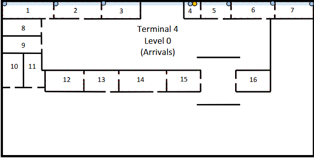
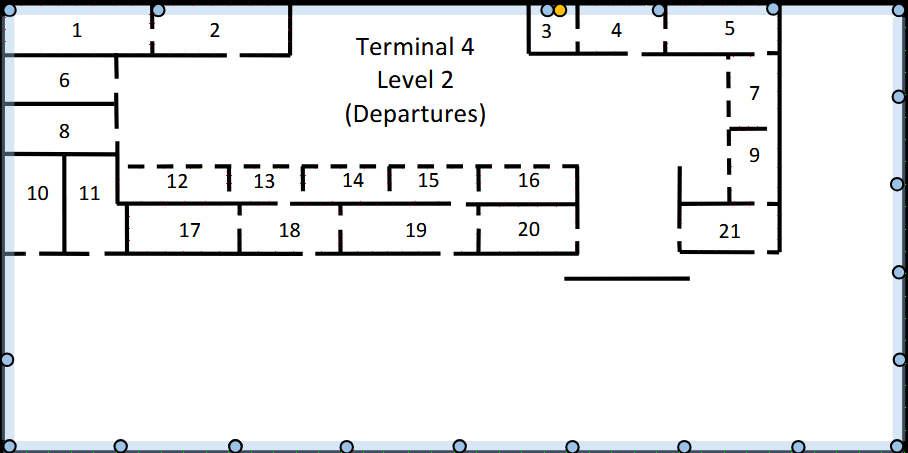
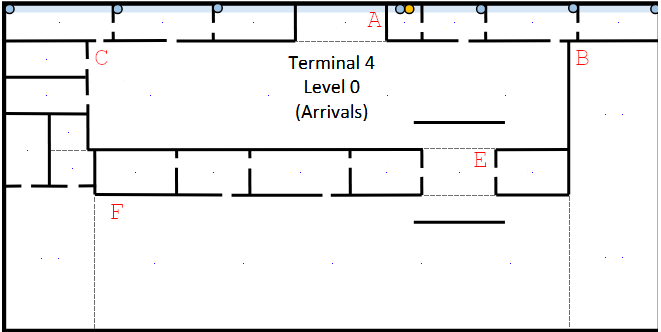
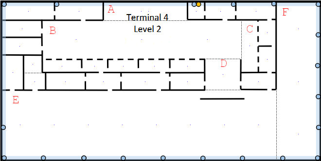

# Terminal 4 

---

## 1. Scale & Measurements

* **Building dimensions:** 200$m$ × 100$m$ = 20000 $m^2$;
* **Scale Used:** 2.9$cm$ = 50$m$ → 1$cm$ = 17.2414$m$;

---

## 2. Network Outlets  Calculation

**Standard rule:** 2 outlets per every 10 $m^2$ → `outlets = area / 10 × 2`
> When calculating "(area/10)", the result will always be rounded **up** to ensure full area coverage.

---

### 2.1. Level 0 (Arrivals)

> Rooms **with** standard outlets : 1, 2, 3, 5, 6, 7, 12, 13, 14, 15, 16
> 
> Rooms **without** outlets : 4 (HC), 8, 9, 10, 11

---

#### 2.1.1. Room Areas & Outlet Calculation

| Room | Dimensions ($cm$) | Length ($m$) | Width ($m$) | Area ($m^2$) | (Area / 10) (rounded up) | Outlets (x2) |
|------|-------------------|--------------|-------------|--------------|--------------------------|--------------|
| 1    | 1.9 × 0.7         | 32.76        | 12.07       | 395.4        | 40                       | **80**       |
| 2    | 1.8 × 0.7         | 31.03        | 12.07       | 374.5        | 38                       | **76**       |
| 3    | 1.5 × 0.7         | 25.86        | 12.07       | 312.1        | 32                       | **64**       |
| 4    | 0.6 × 0.7         | 10.34        | 12.07       | 124.8        | -                        | -            |
| 5    | 1.2 × 0.7         | 20.69        | 12.07       | 249.7        | 25                       | **50**       |
| 6    | 1.7 × 0.7         | 29.31        | 12.07       | 353.8        | 36                       | **72**       |
| 7    | 1.5 × 0.7         | 25.86        | 12.07       | 312.1        | 32                       | **64**       |
| 8    | 1.5 × 0.7         | 25.86        | 12.07       | 312.1        | -                        | -            |
| 9    | 1.5 × 0.7         | 25.86        | 12.07       | 312.1        | -                        | -            |
| 10   | 0.8 × 1.3         | 13.79        | 22.41       | 309.0        | -                        | -            |
| 11a  | 0.7 × 0.7         | 12.07        | 12.07       | 145.7        | -                        | -            |
| 11b  | 0.8 × 0.6         | 13.79        | 10.34       | 142.6        | -                        | -            |
| 12   | 1.5 × 0.8         | 25.86        | 13.79       | 356.6        | 36                       | **72**       |
| 13   | 1.3 × 0.8         | 22.41        | 13.79       | 309.0        | 31                       | **62**       |
| 14   | 1.8 × 0.8         | 31.03        | 13.79       | 427.9        | 43                       | **86**       |
| 15   | 1.3 × 0.8         | 22.41        | 13.79       | 309.0        | 31                       | **62**       |
| 16   | 1.3 × 0.8         | 22.41        | 13.79       | 309.0        | 31                       | **62**       |

**Total standard outlets for Level 0: 750**

---

#### Schematic Plan (For Standard Outlets Only)
>This schematic shows an example layout for the outlets on the Level. The plan **is not** drawn to scale, as doing so would make the diagram too difficult to read. 
>
>When placing the outlets, no point in each room can be more than 3 meters away from one.
>
>**Red** represents **4** outlets and **Yellow** represents **2** outlets.

**(For clarity, outlets associated with Access Points will be shown on a separate schematic)**

---

### 2.2. Level 2 (Departures)

> Rooms **with** standard outlets: 1, 2, 4, 5, 7, 9, 12, 13, 14, 15, 16, 17, 18, 19, 20, 21
> 
> Rooms **without** outlets: 3 (HC — network infrastructure), 6, 8, 10, 11

---

#### 2.2.1. Room Areas & Outlet Calculation

| Room | Dimensions ($cm$) | Length ($m$) | Width ($m$) | Area ($m^2$) | (Area / 10) (rounded up) | Outlets (x2) |
|------|-------------------|--------------|-------------|--------------|--------------------------|--------------|
| 1    | 1.9 × 0.7         | 32.76        | 12.07       | 395.4        | 40                       | **80**       |
| 2    | 1.8 × 0.7         | 31.03        | 12.07       | 374.9        | 38                       | **76**       |
| 3    | 0.6 × 0.7         | 10.34        | 12.07       | 124.8        | -                        | -            |
| 4    | 1.2 × 0.7         | 20.69        | 12.07       | 249.7        | 25                       | **50**       |
| 5    | 1.5 × 0.7         | 25.86        | 12.07       | 312.4        | 32                       | **64**       |
| 6    | 1.5 × 0.6         | 25.86        | 10.34       | 267.4        | -                        | -            |
| 7    | 0.7 × 1.0         | 12.07        | 17.24       | 208.0        | 21                       | **42**       |
| 8    | 1.5 × 0.6         | 25.86        | 10.34       | 267.4        | -                        | -            |
| 9    | 0.7 × 1.0         | 12.07        | 17.24       | 208.0        | 21                       | **42**       |
| 10   | 0.8 × 1.3         | 13.79        | 22.41       | 309.0        | -                        | -            |
| 11a  | 0.7 × 0.6         | 12.07        | 10.34       | 124.8        | -                        | -            |
| 11b  | 0.8 × 0.7         | 13.79        | 12.07       | 166.4        | -                        | -            |
| 12   | 1.5 × 0.5         | 25.86        | 8.62        | 222.9        | 23                       | **46**       |
| 13   | 1.0 × 0.5         | 17.24        | 8.62        | 148.6        | 15                       | **30**       |
| 14   | 1.2 × 0.5         | 20.69        | 8.62        | 178.3        | 18                       | **36**       |
| 15   | 1.2 × 0.5         | 20.69        | 8.62        | 178.3        | 18                       | **36**       |
| 16   | 1.3 × 0.5         | 22.41        | 8.62        | 193.2        | 20                       | **40**       |
| 17   | 1.5 × 0.7         | 25.86        | 12.07       | 312.4        | 32                       | **64**       |
| 18   | 1.3 × 0.7         | 22.41        | 12.07       | 270.7        | 28                       | **56**       |
| 19   | 1.8 × 0.7         | 31.03        | 12.07       | 374.9        | 38                       | **76**       |
| 20   | 1.3 × 0.7         | 22.41        | 12.07       | 270.7        | 28                       | **56**       |
| 21   | 1.3 × 0.7         | 22.41        | 12.07       | 270.7        | 28                       | **56**       |

**Total standard outlets for Level 2 (excluding external walls): 850**

---

#### 2.2.2. External Wall (Level 2 only)

> As stated on the project requirements, there must be 1 outlet every 5 meters along the **right** and **bottom** external walls of Level 2.

| Wall   | Length ($m$) | Outlets (length / 5) |
|--------|--------------|----------------------|
| Right  | 100          | **20**               |
| Bottom | 200          | **40**               |

However, one outlet will be placed at the corner, meaning it will be a part of both walls, since they form a 90º angle with each other, which means:

**Total standard outlets for external walls on Level 2: 59**

**Total standard outlets for Level 2: 909**

---

#### Schematic Plan (For Standard Outlets Only)
>This schematic shows an example layout for the outlets on the Level. The plan **is not** drawn to scale, as doing so would make the diagram too difficult to read.
>
>When placing the outlets, no point in each room can be more than 3 meters away from one.
>
>**Red** represents **4** outlets, **Yellow** represents **2** outlets and **Green** represents 1 outlet.
 

**(For clarity, outlets associated with Access Points will be shown on a separate schematic)**

---

## 3. Access Points

>Both floors require LAN coverage (Wi-Fi)
> 
> Each Access Point covers a circle of 50$m$ diameter
> 
> All APs will be installed in the space above the dropped ceiling
> 
> Each AP will require **a dedicated outlet**
> 
> All APs on this terminal will operate on **5GHz band**, since this band offers a much larger number of available channels, and it also has **DFS (Dynamic Frequency Selection)**, which selects a channel in order avoid interference with it's neighbours.

---
### 3.1. Calculating amount and positions

> In order to verify how many APs are needed in a certain area, it will be used the following formula:
> $$D_r = \sqrt{length^2 + width^2} \leq D_c = 2 \times radius = 50 \ m$$
> $D_r$ is the diagonal of the rectangle we are currently trying to place APs, and $D_c$ the diameter of an AP (50$m$)
> 
> If the condition is false, we will use the following formula to determine the number of APs on a certain zone (always rounded up):
> $$N = \left\lceil \frac{D_r^2}{2500} \right\rceil$$

---

#### 3.1.1. Level 0 — Rooms

| Room | $D_r = \sqrt{length^2+width^2}$ ($m$) | $D_r \leq 50m$? | Total APs |
|------|---------------------------------------|-----------------|-----------|
| 1    | √(32.8²+12.1²) = 34.91                | Yes             | **1**     |
| 2    | √(31.0²+12.1²) = 33.29                | Yes             | **1**     |
| 3    | √(25.9²+12.1²) = 28.54                | Yes             | **1**     |
| 4    | √(10.3²+12.1²) = 15.89                | Yes             | **1**     |
| 5    | √(20.7²+12.1²) = 23.95                | Yes             | **1**     |
| 6    | √(29.3²+12.1²) = 31.70                | Yes             | **1**     |
| 7    | √(25.9²+12.1²) = 28.54                | Yes             | **1**     |
| 8    | √(25.9²+12.1²) = 28.54                | Yes             | **1**     |
| 9    | √(25.9²+12.1²) = 28.54                | Yes             | **1**     |
| 10   | √(13.8²+22.4²) = 26.31                | Yes             | **1**     |
| 11a  | √(12.1²+12.1²) = 17.07                | Yes             | **1**     |
| 11b  | √(13.8²+10.3²) = 17.24                | Yes             | **1**     |
| 12   | √(25.9²+13.8²) = 29.31                | Yes             | **1**     |
| 13   | √(22.4²+13.8²) = 26.31                | Yes             | **1**     |
| 14   | √(31.0²+13.8²) = 33.96                | Yes             | **1**     |
| 15   | √(22.4²+13.8²) = 26.31                | Yes             | **1**     |
| 16   | √(22.4²+13.8²) = 26.31                | Yes             | **1**     |

**Total APs for Level 0 rooms: 17 APs + 17 Dedicated Outlets**

---

#### 3.1.2 Level 0 - Open Areas

I divided the open areas on this terminal in 6 zones (as it will be shown on the next schematic plan)

| Open Area | Dimensions ($cm$) | Length ($m$) | Width ($m$) | Area ($m^2$) | $D_r = \sqrt{L^2+W^2}$ ($m$) | $D_r \leq 50m$? | Total APs |
|-----------|-------------------|--------------|-------------|--------------|------------------------------|-----------------|-----------|
| A         | 1.1 × 0.7         | 18.97        | 12.07       | 229.0        | √(19.0²+12.1²) = 22.48       | Yes             | **1**     |
| B         | 1.6 × 5.2         | 27.59        | 89.66       | 2473.7       | √(27.6²+89.7²) = 93.81       | No              | **4**     |
| C         | 8.1 × 2.0         | 139.66       | 34.48       | 4815.5       | √(139.7²+34.5²) = 143.85     | No              | **4**     |
| D         | 1.6 × 2.6         | 27.59        | 44.83       | 1236.9       | √(27.6²+44.8²) = 52.64       | No              | **2**     |
| E         | 1.3 × 0.8         | 22.41        | 13.79       | 309.0        | √(22.4²+13.8²) = 26.31       | Yes             | **1**     |
| F         | 8.5 × 2.0         | 146.55       | 34.48       | 5053.0       | √(146.6²+34.5²) = 150.55     | No              | **5**     |

**Total APs for Level 0 open areas: 17 APs + 17 Dedicated Outlets**

**Total APs for Level 0 (rooms + open areas): 34 APs + 34 Dedicated Outlets**

---

**AP Distribution**

> **Formulas:** $R=25m$, $n_{lines} = \lceil W/(2R) \rceil$, $y_i = W(2i-1)/(2n)$, $d = \min(y_i, W-y_i)$, $c = \sqrt{R^2-d^2}$, $n_{APs} = \lfloor (L-2c)/(2c) \rfloor + 2$, spacing $= (L-2c)/(n_{APs}-1)$
>
> W - Width; L - Length; R - AP radius (25m); i - line index (1 to $n_{lines}$)

**Zone B** — $n_{lines}=2$, $d=22.41m$, $c=11.08m$

| AP | X ($m$) | Y ($m$) |
|----|---------|---------|
| 1  | 11.08   | 22.41   |
| 2  | 16.51   | 22.41   |
| 3  | 11.08   | 67.25   |
| 4  | 16.51   | 67.25   |

**Zone C** — $n_{lines}=1$, $d=17.24m$, $c=18.11m$

| AP | X ($m$) | Y ($m$) |
|----|---------|---------|
| 1  | 18.11   | 17.24   |
| 2  | 52.59   | 17.24   |
| 3  | 87.07   | 17.24   |
| 4  | 121.56  | 17.24   |

**Zone D** — $n_{lines}=1$, $d=22.41m$, $c=11.08m$

| AP | X ($m$) | Y ($m$) |
|----|---------|---------|
| 1  | 11.08   | 22.41   |
| 2  | 16.51   | 22.41   |

**Zone F** — $n_{lines}=1$, $d=17.24m$, $c=18.11m$

| AP | X ($m$) | Y ($m$) |
|----|---------|---------|
| 1  | 18.11   | 17.24   |
| 2  | 45.69   | 17.24   |
| 3  | 73.28   | 17.24   |
| 4  | 100.86  | 17.24   |
| 5  | 128.45  | 17.24   |

---

#### Schematic Plan (For APs and Dedicated Outlets)
>This schematic shows how to place the APs and their Dedicated Outlets.
>
> **Blue** represents an AP + Dedicated Outlet

---

#### 3.2.1. Level 2 — Rooms

| Room | Area ($m^2$) | $D_r = \sqrt{L^2+W^2}$ ($m$) | $D_r \leq 50m$? | Total APs |
|------|--------------|------------------------------|-----------------|-----------|
| 1    | 395.4        | √(32.8²+12.1²) = 34.91       | Yes             | **1**     |
| 2    | 374.5        | √(31.0²+12.1²) = 33.29       | Yes             | **1**     |
| 3    | 124.8        | √(10.3²+12.1²) = 15.89       | Yes             | **1**     |
| 4    | 249.7        | √(20.7²+12.1²) = 23.95       | Yes             | **1**     |
| 5    | 312.1        | √(25.9²+12.1²) = 28.54       | Yes             | **1**     |
| 6    | 267.4        | √(25.9²+10.3²) = 27.85       | Yes             | **1**     |
| 7    | 208.1        | √(12.1²+17.2²) = 21.05       | Yes             | **1**     |
| 8    | 267.4        | √(25.9²+10.3²) = 27.85       | Yes             | **1**     |
| 9    | 208.1        | √(12.1²+17.2²) = 21.05       | Yes             | **1**     |
| 10   | 309.0        | √(13.8²+22.4²) = 26.31       | Yes             | **1**     |
| 11a  | 124.8        | √(12.1²+10.3²) = 15.89       | Yes             | **1**     |
| 11b  | 166.4        | √(13.8²+12.1²) = 18.33       | Yes             | **1**     |
| 12   | 222.9        | √(25.9²+8.6²) = 27.26        | Yes             | **1**     |
| 13   | 148.6        | √(17.2²+8.6²) = 19.27        | Yes             | **1**     |
| 14   | 178.3        | √(20.7²+8.6²) = 22.41        | Yes             | **1**     |
| 15   | 178.3        | √(20.7²+8.6²) = 22.41        | Yes             | **1**     |
| 16   | 193.2        | √(22.4²+8.6²) = 24.01        | Yes             | **1**     |
| 17   | 312.1        | √(25.9²+12.1²) = 28.54       | Yes             | **1**     |
| 18   | 270.5        | √(22.4²+12.1²) = 25.45       | Yes             | **1**     |
| 19   | 374.5        | √(31.0²+12.1²) = 33.29       | Yes             | **1**     |
| 20   | 270.5        | √(22.4²+12.1²) = 25.45       | Yes             | **1**     |
| 21   | 270.5        | √(22.4²+12.1²) = 25.45       | Yes             | **1**     |

**Total APs for Level 2 rooms: 22 APs + 22 Dedicated Outlets**

---

#### 3.2.2 Level 2 - Open Areas 
I divided the open areas on this terminal in 6 zones (as it will be shown on the next schematic plan)

| Open Area | Dimensions ($cm$) | Length ($m$) | Width ($m$) | Area ($m^2$) | $D_r = \sqrt{L^2+W^2}$ ($m$) | $D_r \leq 50m$? | Total APs |
|-----------|-------------------|--------------|-------------|--------------|------------------------------|-----------------|-----------|
| A         | 3.1 × 0.7         | 53.45        | 12.07       | 645.1        | √(53.5²+12.1²) = 54.80       | No              | **2**     |
| B         | 7.3 × 1.5         | 125.86       | 25.86       | 3254.7       | √(125.9²+25.9²) = 128.49     | No              | **3**     |
| C         | 0.7 × 1.9         | 12.07        | 32.76       | 395.4        | √(12.1²+32.8²) = 34.91       | Yes             | **1**     |
| D         | 1.3 × 1.2         | 22.41        | 20.69       | 463.7        | √(22.4²+20.7²) = 30.50       | Yes             | **1**     |
| E         | 10.1 × 2.6        | 174.14       | 44.83       | 7806.7       | √(174.1²+44.8²) = 179.82     | No              | **8**     |
| F         | 1.7 × 5.9         | 29.31        | 101.72      | 2981.4       | √(29.3²+101.7²) = 105.86     | No              | **3**     |

**Total APs for Level 2 open areas: 18 APs+ 18 Dedicated Outlets**

**Total APs for Level 2 (rooms + open areas): 40 APs + 40 Dedicated Outlets**

---

**AP Distribution**

>Same method as the other Level

**Zone A** — $n_{lines}=1$, $d=6.04m$, $c=24.26m$

| AP | X ($m$) | Y ($m$) |
|----|---------|---------|
| 1  | 24.26   | 6.04    |
| 2  | 29.19   | 6.04    |

**Zone B** — $n_{lines}=1$, $d=12.93m$, $c=21.40m$

| AP | X ($m$) | Y ($m$) |
|----|---------|---------|
| 1  | 21.40   | 12.93   |
| 2  | 62.93   | 12.93   |
| 3  | 104.46  | 12.93   |

**Zone E** — $n_{lines}=1$, $d=22.41m$, $c=11.07m$

| AP | X ($m$) | Y ($m$) |
|----|---------|---------|
| 1  | 11.08   | 22.41   |
| 2  | 32.79   | 22.41   |
| 3  | 54.50   | 22.41   |
| 4  | 76.21   | 22.41   |
| 5  | 97.93   | 22.41   |
| 6  | 119.64  | 22.41   |
| 7  | 141.35  | 22.41   |
| 8  | 163.06  | 22.41   |

**Zone F** — $n_{lines}=3$, zone too narrow ($L < 2c$); 1 AP per line at $x=L/2=14.65m$

| AP | X ($m$) | Y ($m$) |
|----|---------|---------|
| 1  | 14.65   | 16.95   |
| 2  | 14.65   | 50.86   |
| 3  | 14.65   | 84.77   |

---

#### Schematic Plan (For APs and Dedicated Outlets)
>This schematic shows how to place the APs and their Dedicated Outlets.
>
> **Blue** represents an AP + Dedicated Outlet

---

## 4. HC and CP

