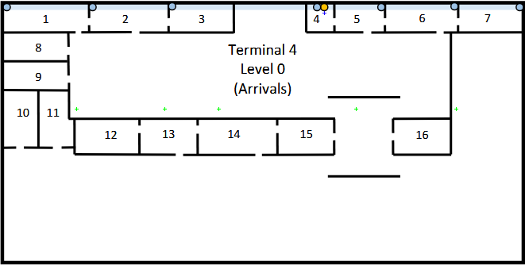
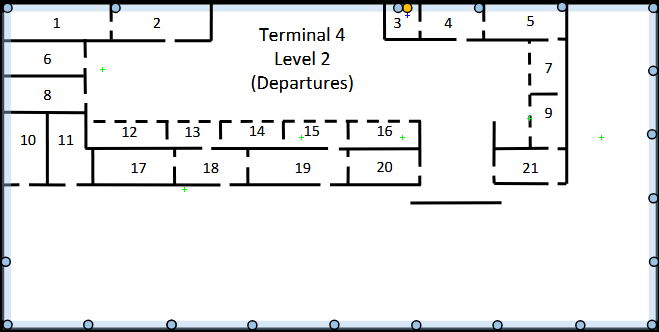
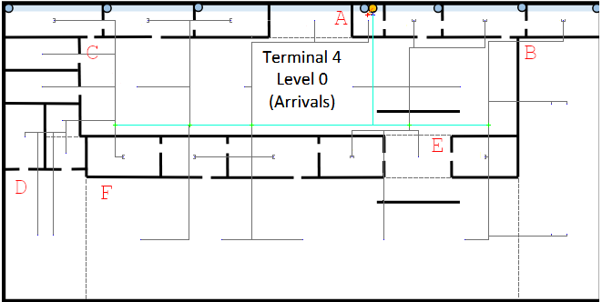
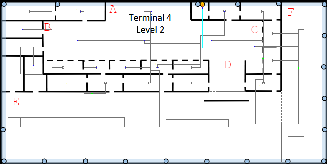

# Terminal 4 

---

## 1. Scale & Measurements

* **Building dimensions:** 200$m$ × 100$m$ = 20000 $m^2$;
* **Scale Used:** 2.9$cm$ = 50$m$ → 1$cm$ = 17.2414$m$;

---

## 2. Network Outlets  Calculation

**Standard rule:** 2 outlets per every 10 $m^2$ → `outlets = area / 10 × 2`
> When calculating "(area/10)", the result will always be rounded **up** to ensure full area coverage.

---

### 2.1. Level 0 (Arrivals)

> Rooms **with** standard outlets : 1, 2, 3, 5, 6, 7, 12, 13, 14, 15, 16
> 
> Rooms **without** outlets : 4 (MC + IC), 8, 9, 10, 11

---

#### 2.1.1. Room Areas & Outlet Calculation

| Room | Dimensions ($cm$) | Length ($m$) | Width ($m$) | Area ($m^2$) | Working Area - (Area / 10) (rounded up) | Outlets (x2) |
|------|-------------------|--------------|-------------|--------------|-----------------------------------------|--------------|
| 1    | 1.9 * 0.7         | 32.76        | 12.07       | 395.4        | 40                                      | **80**       |
| 2    | 1.8 * 0.7         | 31.03        | 12.07       | 374.5        | 38                                      | **76**       |
| 3    | 1.5 * 0.7         | 25.86        | 12.07       | 312.1        | 32                                      | **64**       |
| 4    | 0.6 * 0.7         | 10.34        | 12.07       | 124.8        | -                                       | -            |
| 5    | 1.2 * 0.7         | 20.69        | 12.07       | 249.7        | 25                                      | **50**       |
| 6    | 1.7 * 0.7         | 29.31        | 12.07       | 353.8        | 36                                      | **72**       |
| 7    | 1.5 * 0.7         | 25.86        | 12.07       | 312.1        | 32                                      | **64**       |
| 8    | 1.5 * 0.7         | 25.86        | 12.07       | 312.1        | -                                       | -            |
| 9    | 1.5 * 0.7         | 25.86        | 12.07       | 312.1        | -                                       | -            |
| 10   | 0.8 * 1.3         | 13.79        | 22.41       | 309.0        | -                                       | -            |
| 11a  | 0.7 * 0.7         | 12.07        | 12.07       | 145.7        | -                                       | -            |
| 11b  | 0.8 * 0.6         | 13.79        | 10.34       | 142.6        | -                                       | -            |
| 12   | 1.5 * 0.8         | 25.86        | 13.79       | 356.6        | 36                                      | **72**       |
| 13   | 1.3 * 0.8         | 22.41        | 13.79       | 309.0        | 31                                      | **62**       |
| 14   | 1.8 * 0.8         | 31.03        | 13.79       | 427.9        | 43                                      | **86**       |
| 15   | 1.3 * 0.8         | 22.41        | 13.79       | 309.0        | 31                                      | **62**       |
| 16   | 1.3 * 0.8         | 22.41        | 13.79       | 309.0        | 31                                      | **62**       |

**Total standard outlets for Level 0: 750**

---

#### Schematic Plan (For Standard Outlets Only)
>This schematic shows an example layout for the outlets on the Level. The plan **is not** drawn to scale, as doing so would make the diagram too difficult to read. 
>
>When placing the outlets, no point in each room can be more than 3 meters away from one.
>
>**Red** represents **4** outlets and **Yellow** represents **2** outlets.

**(For clarity, outlets associated with Access Points will be shown on a separate schematic)**

---

### 2.2. Level 2 (Departures)

> Rooms **with** standard outlets: 1, 2, 4, 5, 7, 9, 12, 13, 14, 15, 16, 17, 18, 19, 20, 21
> 
> Rooms **without** outlets: 3 (IC), 6, 8, 10, 11

---

#### 2.2.1. Room Areas & Outlet Calculation

| Room | Dimensions ($cm$) | Length ($m$) | Width ($m$) | Area ($m^2$) | Working Area - (Area / 10) (rounded up) | Outlets (x2) |
|------|-------------------|--------------|-------------|--------------|-----------------------------------------|--------------|
| 1    | 1.9 * 0.7         | 32.76        | 12.07       | 395.4        | 40                                      | **80**       |
| 2    | 1.8 * 0.7         | 31.03        | 12.07       | 374.9        | 38                                      | **76**       |
| 3    | 0.6 * 0.7         | 10.34        | 12.07       | 124.8        | -                                       | -            |
| 4    | 1.2 * 0.7         | 20.69        | 12.07       | 249.7        | 25                                      | **50**       |
| 5    | 1.5 * 0.7         | 25.86        | 12.07       | 312.4        | 32                                      | **64**       |
| 6    | 1.5 * 0.6         | 25.86        | 10.34       | 267.4        | -                                       | -            |
| 7    | 0.7 * 1.0         | 12.07        | 17.24       | 208.0        | 21                                      | **42**       |
| 8    | 1.5 * 0.6         | 25.86        | 10.34       | 267.4        | -                                       | -            |
| 9    | 0.7 * 1.0         | 12.07        | 17.24       | 208.0        | 21                                      | **42**       |
| 10   | 0.8 * 1.3         | 13.79        | 22.41       | 309.0        | -                                       | -            |
| 11a  | 0.7 * 0.6         | 12.07        | 10.34       | 124.8        | -                                       | -            |
| 11b  | 0.8 * 0.7         | 13.79        | 12.07       | 166.4        | -                                       | -            |
| 12   | 1.5 * 0.5         | 25.86        | 8.62        | 222.9        | 23                                      | **46**       |
| 13   | 1.0 * 0.5         | 17.24        | 8.62        | 148.6        | 15                                      | **30**       |
| 14   | 1.2 * 0.5         | 20.69        | 8.62        | 178.3        | 18                                      | **36**       |
| 15   | 1.2 * 0.5         | 20.69        | 8.62        | 178.3        | 18                                      | **36**       |
| 16   | 1.3 * 0.5         | 22.41        | 8.62        | 193.2        | 20                                      | **40**       |
| 17   | 1.5 * 0.7         | 25.86        | 12.07       | 312.4        | 32                                      | **64**       |
| 18   | 1.3 * 0.7         | 22.41        | 12.07       | 270.7        | 28                                      | **56**       |
| 19   | 1.8 * 0.7         | 31.03        | 12.07       | 374.9        | 38                                      | **76**       |
| 20   | 1.3 * 0.7         | 22.41        | 12.07       | 270.7        | 28                                      | **56**       |
| 21   | 1.3 * 0.7         | 22.41        | 12.07       | 270.7        | 28                                      | **56**       |

**Total standard outlets for Level 2 (excluding external walls): 850**

---

#### 2.2.2. External Wall (Level 2 only)

> As stated on the project requirements, there must be 1 outlet every 5 meters along the **right** and **bottom** external walls of Level 2.

| Wall   | Length ($m$) | Outlets (length / 5) |
|--------|--------------|----------------------|
| Right  | 100          | **20**               |
| Bottom | 200          | **40**               |

However, one outlet will be placed at the corner, meaning it will be a part of both walls, since they form a 90º angle with each other, which means:

**Total standard outlets for external walls on Level 2: 59**

**Total standard outlets for Level 2: 909**

---

#### Schematic Plan (For Standard Outlets Only)
>This schematic shows an example layout for the outlets on the Level. The plan **is not** drawn to scale, as doing so would make the diagram too difficult to read.
>
>When placing the outlets, no point in each room can be more than 3 meters away from one.
>
>**Red** represents **4** outlets, **Yellow** represents **2** outlets and **Green** represents 1 outlet.
 

**(For clarity, outlets associated with Access Points will be shown on a separate schematic)**

---

## 3. Access Points

> Both floors require LAN coverage (Wi-Fi)
> 
> Each Access Point covers a circle of 50$m$ diameter
> 
> All APs will be installed in the space above the dropped ceiling
> 
> Each AP will require **a dedicated outlet**
> 
> All APs on this terminal will operate on **5GHz band**, since this band offers a much larger number of available channels, and it also has **DFS (Dynamic Frequency Selection)**, which selects a channel in order to avoid overlapping with nearby detected cells.

---
### 3.1. Calculating amount and positions

> In order to verify how many APs are needed in a certain area, it will be used the following formula:
> $$D_r = \sqrt{length^2 + width^2} \leq D_c = 2 \times radius = 50 \ m$$
> $D_r$ is the diagonal of the rectangle we are currently trying to place APs, and $D_c$ the diameter of an AP (50$m$)
> 
> If the condition is false, we will use the following formula to determine the number of APs on a certain zone (always rounded up):
> $$N = \left\lceil \frac{D_r^2}{2500} \right\rceil$$

---

#### 3.1.1. Level 0 — Rooms

| Room | $D_r = \sqrt{length^2+width^2}$ ($m$) | $D_r \leq 50m$? | Total APs |
|------|---------------------------------------|-----------------|-----------|
| 1    | √(32.8²+12.1²) = 34.91                | Yes             | **1**     |
| 2    | √(31.0²+12.1²) = 33.29                | Yes             | **1**     |
| 3    | √(25.9²+12.1²) = 28.54                | Yes             | **1**     |
| 4    | √(10.3²+12.1²) = 15.89                | Yes             | **1**     |
| 5    | √(20.7²+12.1²) = 23.95                | Yes             | **1**     |
| 6    | √(29.3²+12.1²) = 31.70                | Yes             | **1**     |
| 7    | √(25.9²+12.1²) = 28.54                | Yes             | **1**     |
| 8    | √(25.9²+12.1²) = 28.54                | Yes             | **1**     |
| 9    | √(25.9²+12.1²) = 28.54                | Yes             | **1**     |
| 10   | √(13.8²+22.4²) = 26.31                | Yes             | **1**     |
| 11a  | √(12.1²+12.1²) = 17.07                | Yes             | **1**     |
| 11b  | √(13.8²+10.3²) = 17.24                | Yes             | **1**     |
| 12   | √(25.9²+13.8²) = 29.31                | Yes             | **1**     |
| 13   | √(22.4²+13.8²) = 26.31                | Yes             | **1**     |
| 14   | √(31.0²+13.8²) = 33.96                | Yes             | **1**     |
| 15   | √(22.4²+13.8²) = 26.31                | Yes             | **1**     |
| 16   | √(22.4²+13.8²) = 26.31                | Yes             | **1**     |

**Total APs for Level 0 rooms: 17 APs + 17 Dedicated Outlets**

---

#### 3.1.2 Level 0 - Open Areas

I divided the open areas on this terminal in 6 zones (as it will be shown on the next schematic plan)

| Open Area | Dimensions ($cm$) | Length ($m$) | Width ($m$) | Area ($m^2$) | $D_r = \sqrt{L^2+W^2}$ ($m$) | $D_r \leq 50m$? | Total APs |
|-----------|-------------------|--------------|-------------|--------------|------------------------------|-----------------|-----------|
| A         | 1.1 × 0.7         | 18.97        | 12.07       | 229.0        | √(19.0²+12.1²) = 22.48       | Yes             | **1**     |
| B         | 1.6 × 5.2         | 27.59        | 89.66       | 2473.7       | √(27.6²+89.7²) = 93.81       | No              | **4**     |
| C         | 8.1 × 2.0         | 139.66       | 34.48       | 4815.5       | √(139.7²+34.5²) = 143.85     | No              | **4**     |
| D         | 1.6 × 2.6         | 27.59        | 44.83       | 1236.9       | √(27.6²+44.8²) = 52.64       | No              | **2**     |
| E         | 1.3 × 0.8         | 22.41        | 13.79       | 309.0        | √(22.4²+13.8²) = 26.31       | Yes             | **1**     |
| F         | 8.5 × 2.0         | 146.55       | 34.48       | 5053.0       | √(146.6²+34.5²) = 150.55     | No              | **5**     |

**Total APs for Level 0 open areas: 17 APs + 17 Dedicated Outlets**

**Total APs for Level 0 (rooms + open areas): 34 APs + 34 Dedicated Outlets**

---

**AP Distribution**

> **Formulas:** $R=25m$, $n_{lines} = \lceil W/(2R) \rceil$, $y_i = W(2i-1)/(2n)$, $d = \min(y_i, W-y_i)$, $c = \sqrt{R^2-d^2}$, $n_{APs} = \lfloor (L-2c)/(2c) \rfloor + 2$, spacing $= (L-2c)/(n_{APs}-1)$
>
> W - Width; L - Length; R - AP radius (25m); i - line index (1 to $n_{lines}$)
> 
> These coordinates are local to the zone itself, for future calculations, it will be used global coordinates

**Zone B** — $n_{lines}=2$, $d=22.41m$, $c=11.08m$

| AP | X ($m$) | Y ($m$) |
|----|---------|---------|
| 1  | 11.08   | 22.41   |
| 2  | 16.51   | 22.41   |
| 3  | 11.08   | 67.25   |
| 4  | 16.51   | 67.25   |

**Zone C** — $n_{lines}=1$, $d=17.24m$, $c=18.11m$

| AP | X ($m$) | Y ($m$) |
|----|---------|---------|
| 1  | 18.11   | 17.24   |
| 2  | 52.59   | 17.24   |
| 3  | 87.07   | 17.24   |
| 4  | 121.56  | 17.24   |

**Zone D** — $n_{lines}=1$, $d=22.41m$, $c=11.08m$

| AP | X ($m$) | Y ($m$) |
|----|---------|---------|
| 1  | 11.08   | 22.41   |
| 2  | 16.51   | 22.41   |

**Zone F** — $n_{lines}=1$, $d=17.24m$, $c=18.11m$

| AP | X ($m$) | Y ($m$) |
|----|---------|---------|
| 1  | 18.11   | 17.24   |
| 2  | 45.69   | 17.24   |
| 3  | 73.28   | 17.24   |
| 4  | 100.86  | 17.24   |
| 5  | 128.45  | 17.24   |

---

#### Schematic Plan (For APs and Dedicated Outlets)
>This schematic shows how to place the APs and their Dedicated Outlets.
>
> **Blue** represents an AP + Dedicated Outlet

---

#### 3.2.1. Level 2 — Rooms

| Room | Area ($m^2$) | $D_r = \sqrt{L^2+W^2}$ ($m$) | $D_r \leq 50m$? | Total APs |
|------|--------------|------------------------------|-----------------|-----------|
| 1    | 395.4        | √(32.8²+12.1²) = 34.91       | Yes             | **1**     |
| 2    | 374.5        | √(31.0²+12.1²) = 33.29       | Yes             | **1**     |
| 3    | 124.8        | √(10.3²+12.1²) = 15.89       | Yes             | **1**     |
| 4    | 249.7        | √(20.7²+12.1²) = 23.95       | Yes             | **1**     |
| 5    | 312.1        | √(25.9²+12.1²) = 28.54       | Yes             | **1**     |
| 6    | 267.4        | √(25.9²+10.3²) = 27.85       | Yes             | **1**     |
| 7    | 208.1        | √(12.1²+17.2²) = 21.05       | Yes             | **1**     |
| 8    | 267.4        | √(25.9²+10.3²) = 27.85       | Yes             | **1**     |
| 9    | 208.1        | √(12.1²+17.2²) = 21.05       | Yes             | **1**     |
| 10   | 309.0        | √(13.8²+22.4²) = 26.31       | Yes             | **1**     |
| 11a  | 124.8        | √(12.1²+10.3²) = 15.89       | Yes             | **1**     |
| 11b  | 166.4        | √(13.8²+12.1²) = 18.33       | Yes             | **1**     |
| 12   | 222.9        | √(25.9²+8.6²) = 27.26        | Yes             | **1**     |
| 13   | 148.6        | √(17.2²+8.6²) = 19.27        | Yes             | **1**     |
| 14   | 178.3        | √(20.7²+8.6²) = 22.41        | Yes             | **1**     |
| 15   | 178.3        | √(20.7²+8.6²) = 22.41        | Yes             | **1**     |
| 16   | 193.2        | √(22.4²+8.6²) = 24.01        | Yes             | **1**     |
| 17   | 312.1        | √(25.9²+12.1²) = 28.54       | Yes             | **1**     |
| 18   | 270.5        | √(22.4²+12.1²) = 25.45       | Yes             | **1**     |
| 19   | 374.5        | √(31.0²+12.1²) = 33.29       | Yes             | **1**     |
| 20   | 270.5        | √(22.4²+12.1²) = 25.45       | Yes             | **1**     |
| 21   | 270.5        | √(22.4²+12.1²) = 25.45       | Yes             | **1**     |

**Total APs for Level 2 rooms: 22 APs + 22 Dedicated Outlets**

---

#### 3.2.2 Level 2 - Open Areas 
I divided the open areas on this terminal in 6 zones (as it will be shown on the next schematic plan)

| Open Area | Dimensions ($cm$) | Length ($m$) | Width ($m$) | Area ($m^2$) | $D_r = \sqrt{L^2+W^2}$ ($m$) | $D_r \leq 50m$? | Total APs |
|-----------|-------------------|--------------|-------------|--------------|------------------------------|-----------------|-----------|
| A         | 3.1 × 0.7         | 53.45        | 12.07       | 645.1        | √(53.5²+12.1²) = 54.80       | No              | **2**     |
| B         | 7.3 × 1.5         | 125.86       | 25.86       | 3254.7       | √(125.9²+25.9²) = 128.49     | No              | **3**     |
| C         | 0.7 × 1.9         | 12.07        | 32.76       | 395.4        | √(12.1²+32.8²) = 34.91       | Yes             | **1**     |
| D         | 1.3 × 1.2         | 22.41        | 20.69       | 463.7        | √(22.4²+20.7²) = 30.50       | Yes             | **1**     |
| E         | 10.1 × 2.6        | 174.14       | 44.83       | 7806.7       | √(174.1²+44.8²) = 179.82     | No              | **8**     |
| F         | 1.7 × 5.9         | 29.31        | 101.72      | 2981.4       | √(29.3²+101.7²) = 105.86     | No              | **3**     |

**Total APs for Level 2 open areas: 18 APs+ 18 Dedicated Outlets**

**Total APs for Level 2 (rooms + open areas): 40 APs + 40 Dedicated Outlets**

---

**AP Distribution**

>Same method as the other Level

**Zone A** — $n_{lines}=1$, $d=6.04m$, $c=24.26m$

| AP | X ($m$) | Y ($m$) |
|----|---------|---------|
| 1  | 24.26   | 6.04    |
| 2  | 29.19   | 6.04    |

**Zone B** — $n_{lines}=1$, $d=12.93m$, $c=21.40m$

| AP | X ($m$) | Y ($m$) |
|----|---------|---------|
| 1  | 21.40   | 12.93   |
| 2  | 62.93   | 12.93   |
| 3  | 104.46  | 12.93   |

**Zone E** — $n_{lines}=1$, $d=22.41m$, $c=11.07m$

| AP | X ($m$) | Y ($m$) |
|----|---------|---------|
| 1  | 11.08   | 22.41   |
| 2  | 32.79   | 22.41   |
| 3  | 54.50   | 22.41   |
| 4  | 76.21   | 22.41   |
| 5  | 97.93   | 22.41   |
| 6  | 119.64  | 22.41   |
| 7  | 141.35  | 22.41   |
| 8  | 163.06  | 22.41   |

**Zone F** — $n_{lines}=3$, zone too narrow ($L < 2c$); 1 AP per line at $x=L/2=14.65m$

| AP | X ($m$) | Y ($m$) |
|----|---------|---------|
| 1  | 14.65   | 16.95   |
| 2  | 14.65   | 50.86   |
| 3  | 14.65   | 84.77   |

---

#### Schematic Plan (For APs and Dedicated Outlets)
>This schematic shows how to place the APs and their Dedicated Outlets.
>
> **Blue** represents an AP + Dedicated Outlet

---

## 4. Cross Connections
 
>Each cable (whatever their type is) length should be less than 90$m$
> 
>Straight line distance between the horizontal cross-connect should be less than 80 meters
> 
>Cables connecting an IC to a HC are limited to 500 meters long
> 
>Cables connecting an MC to an IC are limited to 1500 meters long
> 
>Each enclosure has a size of 42U, which means, it fits 200 connections (1U must be free)
>
>There needs to be one IC per level
> 
>All HCs will be placed on the dropped ceiling 

---

### 4.1. Positioning of HCs 

HCs will be positioned in places where they can serve the biggest amount of rooms/open areas as possible. To verify the straight distance between an outlet and a HC, it will be used:

$$d = \sqrt{(cx_{room} - x_{HC})^2 + (cy_{room} - y_{HC})^2}$$

On **Level 0**, we will place **5 HCs**

On **Level 2**, we will place **6 HCs**

Since CPs (Consolidation Points) adds an extra connection point in horizontal cable pathways, and since it increases the chances of a potential point of failure (making it harder to understand where the fault is), HCs will be placed in a way where CPs won't be needed.

The **X** coordinate of an HC will be chosen based on the rooms they will serve, while the **Y** coordinate will be chosen based on the midpoint between 2 rooms heights, or chosen in a way that reduces cable length.

---

### 4.2. Level 0 - HCs positions and rooms/areas assigned

The IC will be placed within the Room 4, in this case, I considered X = 118 & Y = 3, since it makes the IC stand close to the vertical passageway
The MC will be placed next to this IC.

| HC      | X ($m$) | Y ($m$) | Rooms served                     | Outlets | APs | APs served                 | Total   |
|---------|---------|---------|----------------------------------|---------|-----|----------------------------|---------|
| HC-L0-1 | 37      | 41      | R1, R8, R9, R10, R11a, R11b, R12 | 152     | 9   | 7 room APs + zone D        | **161** |
| HC-L0-2 | 62      | 41      | R2, R3                           | 140     | 4   | 2 room APs + zones C, F    | **144** |
| HC-L0-3 | 83      | 41      | R4, R13, R14                     | 148     | 7   | 3 room APs + zones A, C, F | **155** |
| HC-L0-4 | 136     | 41      | R5, R6, R15                      | 184     | 7   | 3 room APs + zones C, E, F | **191** |
| HC-L0-5 | 175     | 41      | R7, R16                          | 126     | 7   | 2 room APs + zones B, F    | **133** |

**Total: 5 HCs**

---

#### 4.2.1. Level 0 - Cable Distance Validation

All distances will be measured on a straight-line from HC to the room center or the AP position. If $d > 90m$, a CP is required.

**HC-L0-01**

| Connection | Coordinates | Distance |
|:-----------|:------------|:---------|
| **R1**     | (16, 6)     | 41$m$    |
| **R8**     | (6, 18)     | 39$m$    |
| **R9**     | (6, 29)     | 33$m$    |
| **R10**    | (7, 68)     | 41$m$    |
| **R11a**   | (20, 63)    | 28$m$    |
| **R11b**   | (21, 74)    | 37$m$    |
| **R12**    | (41, 76)    | 35$m$    |
| **D-AP1**  | (11, 57)    | 30$m$    |
| **D-AP2**  | (17, 57)    | 26$m$    |

**HC-L0-2**

| Connection | Coordinates | Distance |
|:-----------|:------------|:---------|
| **R2**     | (48, 6)     | 38$m$    |
| **R3**     | (77, 6)     | 38$m$    |
| **C-AP1**  | (46, 17)    | 29$m$    |
| **F-AP1**  | (46, 72)    | 35$m$    |

**HC-L0-3**

| Connection | Coordinates | Distance |
|:-----------|:------------|:---------|
| **R4**     | (109, 6)    | 43$m$    |
| **R13**    | (65, 76)    | 39$m$    |
| **R14**    | (91, 76)    | 36$m$    |
| **A-AP1**  | (94, 6)     | 37$m$    |
| **C-AP2**  | (80, 17)    | 24$m$    |
| **F-AP2**  | (73, 72)    | 33$m$    |
| **F-AP3**  | (101, 72)   | 36$m$    |

**HC-L0-4**

| Connection | Coordinates | Distance |
|:-----------|:------------|:---------|
| **R5**     | (124, 6)    | 37$m$    |
| **R6**     | (149, 6)    | 37$m$    |
| **R15**    | (118, 76)   | 39$m$    |
| **C-AP3**  | (115, 17)   | 32$m$    |
| **C-AP4**  | (149, 17)   | 27$m$    |
| **E-AP1**  | (141, 62)   | 21$m$    |
| **F-AP4**  | (128, 72)   | 32$m$    |

**HC-L0-5**

| Connection | Coordinates | Distance |
|:-----------|:------------|:---------|
| **R7**     | (177, 6)    | 35$m$    |
| **R16**    | (175, 76)   | 35$m$    |
| **F-AP5**  | (156, 72)   | 37$m$    |
| **B-AP1**  | (183, 32)   | 12$m$    |
| **B-AP2**  | (189, 32)   | 16$m$    |
| **B-AP3**  | (183, 77)   | 37$m$    |
| **B-AP4**  | (189, 77)   | 39$m$    |

---
#### Schematic Plan (Cross Connections)
>This schematic shows how to place MC, IC and HCs on Level 0
>
> **Red** represents the MC, **Blue** the IC and **Green** a HC

---

### 4.3. Level 2 - HCs positions and rooms/areas assigned

The IC will be placed within the Room 3, in this case, I considered X = 118 & Y = 3, since it makes the IC stand close to the vertical passageway

| HC      | X ($m$) | Y ($m$) | Rooms served                          | Outlets | APs | APs served                    | Outlets (External Walls) | Total   |
|---------|---------|---------|---------------------------------------|---------|-----|-------------------------------|--------------------------|---------|
| HC-L2-1 | 30      | 20      | R1, R6, R8, R10, R11a, R11b, R12, R17 | 190     | 8   | 8 room APs                    | 0                        | **198** |
| HC-L2-2 | 55      | 57      | R2, R13, R18                          | 162     | 7   | 3 room APs + zone E           | 19                       | **188** |
| HC-L2-3 | 91      | 41      | R3, R14, R19                          | 112     | 7   | 3 room APs + zones A, B, E    | 2                        | **121** |
| HC-L2-4 | 122     | 41      | R4, R15, R16, R20                     | 182     | 7   | 4 room APs + zones B, E       | 9                        | **198** |
| HC-L2-5 | 161     | 35      | R5, R21                               | 120     | 3   | 2 room APs + zone B           | 1                        | **124** |
| HC-L2-6 | 183     | 41      | R7, R9                                | 84      | 8   | 2 room APs + zones C, D, E, F | 28                       | **120** |

**Total: 6 HCs**

---

#### 4.3.1. Level 2 - Cable Distance Validation

**HC-L2-1**

| Connection | Coordinates | Distance |
|:-----------|:------------|:---------|
| **R1**     | (16, 6)     | 20$m$    |
| **R6**     | (13, 17)    | 18$m$    |
| **R8**     | (13, 28)    | 19$m$    |
| **R10**    | (7, 66)     | 52$m$    |
| **R11a**   | (20, 60)    | 42$m$    |
| **R11b**   | (21, 72)    | 53$m$    |
| **R12**    | (41, 53)    | 35$m$    |
| **R17**    | (41, 63)    | 45$m$    |

**HC-L2-2**

| Connection              | Coordinates                                                   | Distance |
|:------------------------|:--------------------------------------------------------------|:---------|
| **R2**                  | (48, 6)                                                       | 52$m$    |
| **R13**                 | (62, 53)                                                      | 9$m$     |
| **R18**                 | (69, 63)                                                      | 16$m$    |
| **E-AP1**               | (11, 91)                                                      | 56$m$    |
| **E-AP2**               | (33, 91)                                                      | 41$m$    |
| **E-AP3**               | (55, 91)                                                      | 35$m$    |
| **E-AP4**               | (76, 91)                                                      | 41$m$    |
| **External Walls (19)** | Max distance at (5, 100) using underground pathway at (1, 99) | 79$m$    |

**HC-L2-3**

| Connection             | Coordinates                                                       | Distance |
|:-----------------------|:------------------------------------------------------------------|:---------|
| **R3**                 | (109, 6)                                                          | 40$m$    |
| **R14**                | (86, 53)                                                          | 13$m$    |
| **R19**                | (100, 63)                                                         | 24$m$    |
| **A-AP1**              | (88, 6)                                                           | 36$m$    |
| **A-AP2**              | (93, 6)                                                           | 35$m$    |
| **B-AP1**              | (85, 25)                                                          | 17$m$    |
| **E-AP5**              | (98, 91)                                                          | 51$m$    |
| **External Walls (2)** | Max distance at (100, 100) using underground pathway at (100, 99) | 64$m$    |

**HC-L2-4**

| Connection             | Coordinates                                                       | Distance |
|:-----------------------|:------------------------------------------------------------------|:---------|
| **R4**                 | (124, 6)                                                          | 35$m$    |
| **R15**                | (107, 53)                                                         | 27$m$    |
| **R16**                | (128, 53)                                                         | 8$m$     |
| **R20**                | (127, 63)                                                         | 23$m$    |
| **B-AP2**              | (127, 25)                                                         | 17$m$    |
| **E-AP6**              | (120, 91)                                                         | 51$m$    |
| **E-AP7**              | (141, 91)                                                         | 54$m$    |
| **External Walls (9)** | Max distance at (145, 100) using underground pathway at (152, 99) | 78$m$    |

**HC-L2-5**

| Connection            | Coordinates                                                           | Distance |
|:----------------------|:----------------------------------------------------------------------|:---------|
| **R5**                | (161, 6)                                                              | 29$m$    |
| **R21**               | (166, 59)                                                             | 26$m$    |
| **B-AP3**             | (168, 25)                                                             | 13$m$    |
| **External Wall (1)** | Max distance at (155, 100) using underground pathway at (151.5, 99.4) | 70$m$    |

**HC-L2-6**

| Connection              | Coordinates                                                       | Distance |
|:------------------------|:------------------------------------------------------------------|:---------|
| **R7**                  | (167, 19)                                                         | 27$m$    |
| **R9**                  | (167, 36)                                                         | 17$m$    |
| **C-AP1**               | (156, 27)                                                         | 30$m$    |
| **D-AP1**               | (139, 45)                                                         | 44$m$    |
| **E-AP5**               | (161, 77)                                                         | 43$m$    |
| **F-AP1**               | (187, 17)                                                         | 24$m$    |
| **F-AP2**               | (187, 83)                                                         | 43$m$    |
| **F-AP3**               | (187, 83)                                                         | 43$m$    |
| **External Walls (28)** | Max distance at (160, 100) using underground pathway at (152, 99) | 76$m$    |

---
#### Schematic Plan (Cross Connections)
>This schematic shows how to place HCs and IC on Level 2
>
> **Blue** represents the IC and **Green** a HC

---

## 5. Cable Pathways

> The cable length is calculated by using the straight line between the HC and the room/area it serves.
> 
> **MC → IC:** The MC will connect to the IC on both levels.
> 
> **IC → HC:** The IC will connect to all HCs on their specific level, using the dropped ceiling.
> 
> **Room outlets:** $d_{HC \to room\_center} \times N_{outlets}$ — in order to simplify calculations
>
> **APs (room or open area):** $d_{HC \to AP\_position}$ - since each AP has a dedicated outlet
> 
> **External wall outlets (Level 2):** cables run from the HC horizontally through the dropped ceiling, until the nearest underfloor raceway access point on the external wall, then along the underfloor cable pathway to the outlet position. Cable length = $d_{HC \to access\ point} + d_{raceway\ to\ outlet}$
> 
> **Cable Redundancy** will be considered to connect **MC → IC** and **IC → HC** 

---

### 5.1. MC → IC (Backbone)

The MC and the IC on Level 0 will be co-located, since both of them will be on Room 4. We will consider 1$m$ of cable for this connection.
To connect the MC to the IC on Level 2, we will need to use the vertical passageway to go up 9$m$.

**Total cable length for MC → IC connections: 10$m$**

**Total cable length for MC → IC connections (with cable redundancy): 20$m$**

---

### 5.2. IC → HC 

Since there are 2 ICs, one on each floor, we only need 

| Connection    | Distance |
|---------------|----------|
| IC0 → HC-L0-1 | 89.5$m$  |
| IC0 → HC-L0-2 | 67.7$m$  |
| IC0 → HC-L0-3 | 51.7$m$  |
| IC0 → HC-L0-4 | 42.1$m$  |
| IC0 → HC-L0-5 | 68.5$m$  |
| IC2 → HC-L2-1 | 89.6$m$  |
| IC2 → HC-L2-2 | 82.9$m$  |
| IC2 → HC-L2-3 | 46.5$m$  |
| IC2 → HC-L2-4 | 38.2$m$  |
| IC2 → HC-L2-5 | 53.6$m$  |
| IC2 → HC-L2-6 | 75.3$m$  |

**Total cable length for IC → HC connections : 706$m$**

**Total cable length for IC → HC connections (with cable redundancy) : 1412$m$**

---

### 5.3 HCs → Outlets (Level 0)

| HC                | Type                                                           | Cables  | Total Cable length |
|:------------------|:---------------------------------------------------------------|:--------|:-------------------|
| HC-L0-1           | Room outlets (R1: 41$m$ * 80, R12: 35$m$ * 72)                 | 152     | 5800$m$            |
| HC-L0-1           | APs — 9 cables                                                 | 9       | 290$m$             |
| **HC-L0-1 Total** | -                                                              | **161** | **6090$m$**        |
| HC-L0-2           | Room outlets (R2: 38$m$ * 76, R3: 38$m$ * 64)                  | 140     | 5320$m$            |
| HC-L0-2           | APs — 4 cables                                                 | 4       | 128$m$             |
| **HC-L0-2 Total** | -                                                              | **144** | **5448$m$**        |
| HC-L0-3           | Room outlets (R13: 39$m$ * 62, R14: 36$m$ * 86)                | 148     | 5514$m$            |
| HC-L0-3           | APs  — 7 cables                                                | 7       | 242$m$             |
| **HC-L0-3 Total** | -                                                              | **155** | **5756$m$**        |
| HC-L0-4           | Room outlets (R5: 37$m$ * 50, R6: 37$m$ * 72, R15: 39$m$ * 62) | 184     | 6932$m$            |
| HC-L0-4           | APs — 7 cables                                                 | 7       | 196$m$             |
| **HC-L0-4 Total** | -                                                              | **191** | **7128$m$**        |
| HC-L0-5           | Room outlets (R7: 35$m$ * 64, R16: 35$m$ * 62)                 | 126     | 4410$m$            |
| HC-L0-5           | APs — 7 cables                                                 | 7       | 196$m$             |
| **HC-L0-5 Total** | -                                                              | **133** | **4606$m$**        |
| **Level 0 Total** | -                                                              | **784** | **29028$m$**       |

---

#### Schematic Plan (Cable Pathways)
> This schematic shows the passage of cables from Level 0
> 
> The cables are **not** drawn accurately (since they should be fully horizontal, which means, not doing 90º turns), but they are draw in this way to help visualize better the cable pathways.
>
> **Orange** cables represent a MC → IC connection, **Light Blue** cables represent an IC → HC connection and **Gray** cables represent a HC → Outlet connection.
> 
> If a gray cable splits into more, it means that HC connects to all outlets within that room, not only the AP.
> 
> All the **Light Blue** and **Gray** cables are on the dropped ceiling, and the cables for the outlets will be taken out from the ceiling and use the walls to connect to all outlets.

---

### 5.4. HCs → Outlets — Level 2

| HC                | Type                                                                            | Cables  | Total Cable length |
|:------------------|:--------------------------------------------------------------------------------|:--------|:-------------------|
| HC-L2-1           | Room outlets (R1: 20$m$ * 80, R12: 35$m$ * 46, R17: 45$m$ * 64)                 | 190     | 6090$m$            |
| HC-L2-1           | APs & Special Rooms — 8 cables                                                  | 8       | 294$m$             |
| **HC-L2-1 Total** | -                                                                               | **198** | **6384$m$**        |
| HC-L2-2           | Room outlets (R2: 52$m$ * 76, R13: 9$m$ * 30, R18: 16$m$ * 56)                  | 162     | 5118$m$            |
| HC-L2-2           | APs — 7 cables                                                                  | 7       | 303$m$             |
| HC-L2-2           | External wall outlets — 19 cables                                               | 19      | 1501$m$            |
| **HC-L2-2 Total** | -                                                                               | **188** | **6922$m$**        |
| HC-L2-3           | Room outlets (R14: 13$m$ * 36, R19: 24$m$ * 76)                                 | 112     | 2292$m$            |
| HC-L2-3           | APs & Special Rooms — 7 cables                                                  | 7       | 250$m$             |
| HC-L2-3           | External wall outlets — 2 cables                                                | 2       | 128$m$             |
| **HC-L2-3 Total** | -                                                                               | **121** | **2670$m$**        |
| HC-L2-4           | Room outlets (R4: 35$m$ * 50, R15: 27$m$ * 36, R16: 8$m$ * 40, R20: 23$m$ * 56) | 182     | 4330$m$            |
| HC-L2-4           | APs — 7 cables                                                                  | 7       | 284$m$             |
| HC-L2-4           | External wall outlets — 9 cables                                                | 9       | 702$m$             |
| **HC-L2-4 Total** | -                                                                               | **198** | **5316$m$**        |
| HC-L2-5           | Room outlets (R5: 29$m$ * 64, R21: 26$m$ * 56)                                  | 120     | 3312$m$            |
| HC-L2-5           | APs — 3 cables                                                                  | 3       | 39$m$              |
| HC-L2-5           | External wall outlets — 1 cable                                                 | 1       | 70$m$              |
| **HC-L2-5 Total** | -                                                                               | **124** | **3421$m$**        |
| HC-L2-6           | Room outlets (R7: 27$m$ * 42, R9: 17$m$ * 42)                                   | 84      | 1848$m$            |
| HC-L2-6           | APs — 8 cables                                                                  | 8       | 302$m$             |
| HC-L2-6           | External wall outlets — 28 cables                                               | 28      | 2128$m$            |
| **HC-L2-6 Total** | -                                                                               | **120** | **4278$m$**        |
| **Level 2 Total** | -                                                                               | **949** | **28991$m$**       |

---

#### Schematic Plan (Cable Pathways)
> This schematic shows the passage of cables from Level 2
>
>  The cables are **not** drawn accurately (since they should be fully horizontal, which means, not doing 90º turns),  but they are draw in this way to help visualize better the cable pathways.
>
> **Orange** cables represent a MC → IC connection, **Light Blue** cables represent an IC → HC connection and **Gray** cables represent a HC → Outlet connection.
>
> If a gray cable splits into more, it means that HC connects to all outlets within that room, not only the AP.
>
> All the **Light Blue** and **Gray** cables are on the dropped ceiling, and the cables for the outlets will be taken out from the ceiling and use the walls to connect to all outlets.

---

## 6.Hardware Inventory

| Item                                                | Level 0                               | Level 2                                | **Total**    |
|-----------------------------------------------------|---------------------------------------|----------------------------------------|--------------|
| Main Cross-connect (MC)                             | 1                                     | —                                      | **1**        |
| Intermediate Cross-connects (IC)                    | 1                                     | 1                                      | **2**        |
| Horizontal Cross-connects (HC)                      | 5                                     | 6                                      | **11**       |
| Access Points (Wi-Fi 5GHz)                          | 34                                    | 40                                     | **74**       |
| RJ45 CAT7 Network Outlets                           | 784                                   | 949                                    | **1733**     |
| Copper cable CAT7 (Backbone + IC → HC + Horizontal) | (2$m$ + 640$m$ + 29028$m$) = 29670$m$ | (18$m$ + 772$m$ + 28991$m$) = 29781$m$ | **59451$m$** |
