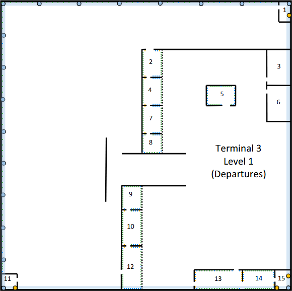
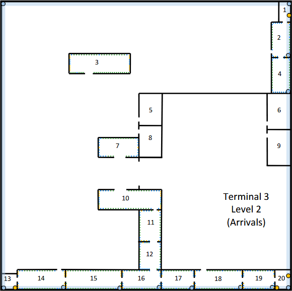
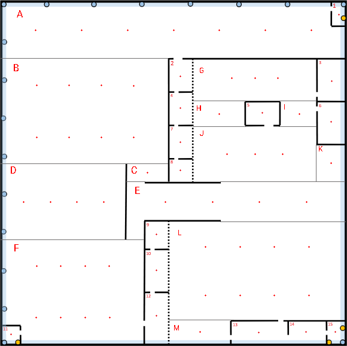
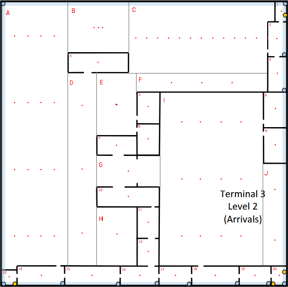

# Terminal 3

---

## 0. Terminal Information

Has five floors.

Project only encompasses the first and second floor.

Wireless LAN coverage required (Wi-Fi).

---

## 1. Level 1 Information

Underfloor cable raceway with access points.

Four vertical cable passageways traveling across all floors of the building.

At a lower floor, these passageways have a direct connection to the external underground passageway.

Vertical distance between this floor and the connection to the external underground passageway is 10m.

Ceiling height is 5m.

Dropped ceiling placed 4m above ground.

Space above dropped ceiling is perfect to install cable raceways and wireless access points.

Rooms 1, 11 and 15 are suitable for housing network infrastructure hardware.

---

## 2. Level 2 Information

Underfloor cable raceway with access points.

Four vertical cable passageways traveling across all the floors of the building.

At a lower floor, these passageways have a direct external connection to the external underground passageway.

Vertical distance between this floor and the connection to the external underground passageway is 16m.

Ceiling height is 5m.

Dropped ceiling placed 4m above ground.

Space above dropped ceiling is perfect to install cable raceways and wireless access points.

Rooms 1, 13 and 20 are suitable for housing network infrastructure hardware.

---

## 3. Scale & Measurements

The measurements will be done utilizing pixels and then converted to meters.

* **Building dimensions:** 200$m$ × 200$m$ = 40000$m^2$;
* **Scale Used:** 577$px$ = 200$m$ → 1$px$ = 0.3466$m$;

**Formula to convert pixels to meters** → `(x * 200)/577 = y`
> x = value in pixels, y = value in meters

---

## 4. Network Outlets Calculation

**Standard rule:** 2 outlets per every 10$m^2$ → `working_areas = area / 10` → `outlets = working_areas × 2`
> When calculating working areas, the result will always be rounded **up** to ensure full area coverage.

---

### 4.1 Level 1 (Arrivals)

> Rooms 2, 4, 5, 7, 8, 9, 10, 12, 13 and 14 are to be provided with the standard number of network outlets (2 per 10m²).
>
> Rooms 1, 3, 6, 11 and 15 are not required to have network outlets.

| Rooms | Dimensions (px) | Dimensions (m) | Area (m^2) | Working Areas | Outlets |
|-------|-----------------|----------------|------------|---------------|---------|
| 1     | 21x38           | 7.28x13.17     | 95.88      | --            | --      |
| 2     | 37x53           | 12.82x18.37    | 235.61     | 24            | 48      |
| 3     | 45x69           | 15.60x23.92    | 373.05     | --            | --      |
| 4     | 37x53           | 12.82x18.37    | 235.61     | 24            | 48      |
| 5     | 55x37           | 19.06x12.82    | 244.50     | 25            | 50      |
| 6     | 45x68           | 15.60x23.57    | 367.55     | --            | --      |
| 7     | 37x53           | 12.82x18.37    | 235.61     | 24            | 48      |
| 8     | 37x37           | 12.82x12.82    | 164.48     | 17            | 34      |
| 9     | 37x45           | 12.82x15.60    | 200.04     | 21            | 42      |
| 10    | 37x68           | 12.82x23.57    | 302.29     | 31            | 62      |
| 11    | 28x28           | 9.71x9.71      | 94.19      | --            | --      |
| 12    | 37x83           | 12.82x28.77    | 368.97     | 37            | 74      |
| 13    | 92x36           | 31.89x12.48    | 397.92     | 40            | 80      |
| 14    | 61x36           | 21.14x12.48    | 263.84     | 27            | 54      |
| 15    | 29x36           | 10.05x12.48    | 125.43     | --            | --      |

> One network outlet (ISO 8877) is required every 5m along the external wall on the left side of the plan and along the external wall at the upper side of the plan.

| Wall | Length ($m$) | Outlets |
|------|--------------|---------|
| Left | 200          | **40**  |
| Top  | 200          | **40**  |

As the walls form a 90º angle with each other, they have a common outlet so, in total, we'll have 79 outlets along the external walls.

**Total standard outlets for Level 1: 540 (Rooms) + 79 (External walls) = 619**

---

### 4.2 Level 2 (Departures)

> Rooms 2, 3, 4, 7, 10, 11, 12, 14, 15, 16, 17, 18 and 19 are to be provided with the standard number of network outlets (2 per 10m²).
> 
> Rooms 1, 5, 6, 8, 9, 13 and 20 are not required to have network outlets.

| Rooms | Dimensions (px) | Dimensions (m) | Area (m^2) | Working Areas | Outlets |
|-------|-----------------|----------------|------------|---------------|---------|
| 1     | 21x38           | 7.28x13.17     | 95.88      | --            | --      |
| 2     | 36x67           | 12.48x23.22    | 289.79     | 29            | 58      |
| 3     | 119x36          | 41.25x12.48    | 514.70     | 52            | 104     |
| 4     | 36x67           | 12.48x23.22    | 289.79     | 29            | 58      |
| 5     | 43x60           | 14.90x20.80    | 309.98     | --            | --      |
| 6     | 44x68           | 15.25x23.57    | 359.48     | --            | --      |
| 7     | 78x35           | 27.04x12.13    | 328.00     | 33            | 66      |
| 8     | 42x59           | 14.56x20.45    | 297.72     | --            | --      |
| 9     | 44x68           | 15.25x23.57    | 359.48     | --            | --      |
| 10    | 123x36          | 42.63x12.48    | 532.01     | 54            | 108     |
| 11    | 42x60           | 14.56x20.80    | 302.77     | 31            | 62      |
| 12    | 42x53           | 14.56x18.37    | 267.44     | 27            | 54      |
| 13    | 28x28           | 9.71x9.71      | 94.19      | --            | --      |
| 14    | 93x36           | 32.24x12.48    | 402.25     | 41            | 82      |
| 15    | 109x36          | 37.78x12.48    | 471.45     | 48            | 86      |
| 16    | 75x36           | 26.00x12.48    | 324.39     | 33            | 66      |
| 17    | 63x36           | 21.84x12.48    | 272.49     | 28            | 56      |
| 18    | 93x36           | 32.24x12.48    | 402.25     | 41            | 82      |
| 19    | 61x36           | 21.14x12.48    | 263.84     | 37            | 74      |
| 20    | 29x36           | 10.05x12.48    | 125.43     | --            | --      |

**Total standard outlets for Level 2: 956**

---

## 5. Access Points Calculations

> Both floors require full LAN coverage.
>
> Each Access Point covers a circular area with 50$m$ of diameter.
>
> All Access Points will be installed in the area between the dropped ceiling and the real ceiling
>
> Each Access Point will require **a dedicated outlet**
>
> All Access Points on this terminal will operate on **5GHz band**, since this band offers a larger number of available channels. Moreover, it also has **DFS (Dynamic Frequency Selection)**, which selects a channel in order avoid interference with its neighbours.

To calculate the number of access points required in a room we will utilize the following formulas:

- $$D_a = \sqrt{length^2 + width^2} \leq D_c $$
- $$D_c = 2 \times radius = 50 \ m$$
    - where $D_a$ is the diagonal of the area is the diagonal of the area we are calculating the access points for.
    - where $D_c$ is the diameter of an access point (50 $m$).

If $D_a \ge D_c$, we will require more than 1 access point. To calculate the exact amount and positions of access points needed in the room/area we utilize the following formulas:

- $$y_i = H(2i-1)/(2n_{lines})$$
    - where $y_i$ is the y coordinate of the line
    - where $H$ is the height of the area
    - where $i$ is the current line
    - where $n_{lines}$

- $$d = min(y_i, H - y_i)$$
    - where $d$ is the distance of the line to the horizontal wall
    - where $H$ is the height of the area
    - where $i$ is the current line
    - where $y_i$ is the y coordinate of the current line

- $$c = \sqrt{R² - d²}$$
    - where $c$ is the distance of the first access point to the vertical wall so that the area covers the corner
    - where $R = 25$
    - where $d$ is the distance of the line to the horizontal wall

- $$n_{lines} = \lceil H/(2R) \rceil$$
    - where $n_{lines}$ is the number of lines of access points and shall always be rounded **up**
    - where $H$ is the height of the area
    - where $R = 25 m$

- $$n_{APs} = \lfloor (L-2c)/(2c) \rfloor + 2$$
    - where $n_{APs}$ is the number of APs per line and shall always be rounded **up**
    - where $L$ is the length of the area
    - where $c$ is the distance of the first access point to the vertical wall so that the area covers the corner

- $$n_{Total} = \sum_{i=1}^{n_{lines}} n_{APs}$$
    - where $n_{Total}$ is the total of access points required in the room/area
    - where $n_{lines} is the number of lines of access points in the room/area
    - where $n_{APs} is the number of access points per line

- $$spacing = (L-2c)/(n_{APs}-1)$$
    - where $spacing$ is the distance between 2 access points
    - where $L$ is the length of the area
    - where $c$ is the distance of the first access point to the vertical wall so that the area covers the corner
    - where $n_{APs} is the number of APs per line

If the room/area only requires 1 access point, we can skip the calculation of $n_{lines}$ and $d = y_i$. The position of the access point will be the center of the room/area.

---

### 5.1. Level 1 (Arrivals)

First we calculate the number of access points required in each of the rooms of Level 1. We do this verification with the condition mentioned before ($D_a \leq D_c$). If the condition is verified to be true, we only require 1 access point, if not, we have to calculate $n$ to obtain the amount required.

| Rooms | $D_a$ (Diagonal) | Number of Acccess Points | Position ($m$) |
|-------|------------------|--------------------------|----------------|
| 1     | 15.05            | 1                        | 3.64x6.585     |
| 2     | 22.40            | 1                        | 6.41x9.185     |
| 3     | 28.56            | 1                        | 7.80x11.96     |
| 4     | 22.40            | 1                        | 6.41x9.185     |
| 5     | 22.97            | 1                        | 9.53x6.41      |
| 6     | 28.26            | 1                        | 7.80x11.785    |
| 7     | 22.40            | 1                        | 6.41x9.185     |
| 8     | 18.13            | 1                        | 6.41x6.41      |
| 9     | 20.19            | 1                        | 6.41x7.80      |
| 10    | 26.83            | 1                        | 6.41x11.785    |
| 11    | 13.73            | 1                        | 4.855x4.855    |
| 12    | 31.49            | 1                        | 6.41x14.385    |
| 13    | 34.24            | 1                        | 15.945x6.24    |
| 14    | 24.55            | 1                        | 10.57x6.24     |
| 15    | 16.02            | 1                        | 5.025x6.24     |

Now we divide the remaining open areas in rectangles and do the same verification that was used previously for the rooms of the level.
The open areas will be identified with letters in the schematic plan.

| Open Areas | Dimensions ($px$) | Dimensions ($m$) | Area ($m²$) | $D_a$ (Diagonal) | Number of Lines | Number of Access Points |
|------------|-------------------|------------------|-------------|------------------|-----------------|-------------------------|
| A          | 573x92            | 198.61x31.89     | 6333.67     | 201.15           | 1               | 7                       |
| B          | 277x174           | 96.01x60.31      | 5790.36     | 113.38           | 2               | 8                       |
| C          | 68x28             | 23.57x9.71       | 228.86      | 25.49            | 1               | 1                       |
| D          | 206x125           | 71.40x43.33      | 3093.762    | 83.52            | 1               | 4                       |
| E          | 364x65            | 126.17x22.53     | 2842.61     | 128.17           | 1               | 4                       |
| F          | 237x172           | 82.15x59.62      | 4897.78     | 101.50           | 2               | 8                       |
| G          | 205x68            | 71.06x23.57      | 1674.88     | 74.87            | 1               | 3                       |
| H          | 85x41             | 29.46x14.21      | 418.63      | 32.71            | 1               | 1                       |
| I          | 59x41             | 20.45x14.21      | 290.60      | 24.90            | 1               | 1                       |
| J          | 205x90            | 71.06x31.20      | 2217.07     | 77.61            | 1               | 3                       |
| K          | 47x60             | 16.29x20.80      | 338.83      | 26.42            | 1               | 1                       |
| L          | 293x162           | 101.56x56.15     | 5702.59     | 116.05           | 2               | 8                       |
| M          | 101x38            | 35.01x13.17      | 461.08      | 37.41            | 1               | 1                       |

**Total Number of Access Points on Level 1: 65**
> Since 1 dedicated outlet is required for each access point, we require another 65 outlets on level 1.

**Open Area A**
- $n_{lines} = 1$
- $y = 15.945 m$
- $d = 15.945 m$
- $c = 19.255 m$
- $n_{APs} = 7$
- $spacing = 26.68 m$

| Access Point | Position ($m$) |
|--------------|----------------|
| 1            | 19.255x15.945  |
| 2            | 45.935x15.945  |
| 3            | 72.615x15.945  |
| 4            | 99.295x15.945  |
| 5            | 125.975x15.945 |
| 6            | 152.655x15.945 |
| 7            | 179.335x15.945 |

**Open Area B**
- $n_{lines} = 2$
- $y_1 = 15.078 m$
- $d_1 = 15.078 m$
- $c_1 = 19.94 m$
- $n_{APs1} = 4$
- $y_2 = 45.232 m$
- $d_2 = 15.078 m$
- $c_2 = 19.94m$
- $n_{APs2} = 4$
- $spacing = 18.71 m$

| Access Point | Position ($m$) |
|--------------|----------------|
| 1            | 19.94x15.078   |
| 2            | 38.65x15.078   |
| 3            | 57.36x15.078   |
| 4            | 76.07x15.078   |
| 5 _          | 19.94x45.232   |
| 6            | 38.65x45.232   |
| 7            | 57.36x45.232   |
| 8            | 76.07x45.232   |

**Open Area D**
- $n_{lines} = 1$
- $y = 21.665 m$
- $d = 21.665 m$
- $c = 12.48 m$
- $n_{APs} = 4$
- $spacing = 15.48 m$

| Access Point | Position ($m$) |
|--------------|----------------|
| 1            | 12.48x21.665   |
| 2            | 27.96x21.665   |
| 3            | 43.44x21.665   |
| 4            | 58.92x21.665   |

**Open Area E**
- $n_{lines} = 1$
- $y = 11.265 m$
- $d = 11.265 m$
- $c = 22.32 m$
- $n_{APs} = 4$
- $spacing = 27.18 m$

| Access Point | Position ($m$) |
|--------------|----------------|
| 1            | 22.32x11.265   |
| 2            | 49.50x11.265   |
| 3            | 76.68x11.265   |
| 4            | 103.86x11.265  |

**Open Area F**

- $n_{lines} = 2$
- $y_1 = 14.91 m$
- $d_1 = 14.91 m$
- $c_1 = 20.067 m$
- $n_{APs1} = 4$
- $spacing_1 = 14.01 m$
- $y_2 = 44.715 m$
- $d_2 = 15.445 m$
- $c_2 = 19.66 m$
- $n_{APs2} = 4
- $spacing_2 = 14.28 m$

| Access Point | Position ($m$) |
|--------------|----------------|
| 1            | 20.067x14.91   |
| 2            | 34.077x14.91   |
| 3            | 48.087x14.91   |
| 4            | 62.097x14.91   |
| 5            | 19.66x44.715   |
| 6            | 33.94x44.715   |
| 7            | 48.22x44.715   |
| 8            | 62.50x44.715   |

**Open Area G**
- $n_{lines} = 1$
- $y = 11.785 m$
- $d = 11.785 m$
- $c = 22.048 m$
- $n_{APs} = 3$
- $spacing = 13.482 m$

| Access Point | Position ($m$) |
|--------------|----------------|
| 1            | 22.048x11.785  |
| 2            | 35.53x11.785   |
| 3            | 49.012x11.785  |

**Open Area J**
- $n_{lines} = 1$
- $y = 15.60 m$
- $d = 15.60 m$
- $c = 19.54 m$
- $n_{APs} = 3$
- $spacing = 15.99 m$

| Access Point | Position ($m$) |
|--------------|----------------|
| 1            | 19.54x15.60    |
| 2            | 35.53x15.60    |
| 3            | 51.52x15.60    |

**Open Area L**
- $n_{lines} = 2$
- $y_1 = 14.04 m$
- $d_1 = 14.04 m$
- $y_2 = 42.11 m$
- $d_2 = 14.04 m$
- $c = 20.69 m$
- $n_{APs} = 4$
- $spacing = 20.06 m$

| Access Point | Position ($m$) |
|--------------|----------------|
| 1            | 20.69x14.04    |
| 2            | 40.75x14.04    |
| 3            | 60.81x14.04    |
| 4            | 80.87x14.04    |
| 5            | 20.69x42.11    |
| 6            | 40.75x42.11    |
| 7            | 60.81x42.11    |
| 8            | 80.87x42.11    |

---

### 5.2. Level 2 (Departures)

| Rooms | $D_a$ (Diagonal) | Number of Acccess Points | Position ($m$) |
|-------|------------------|--------------------------|----------------|
| 1     | 15.05            | 1                        | 3.64x6.585     |
| 2     | 22.40            | 1                        | 6.24x11.61     |
| 3     | 43.10            | 1                        | 20.625x6.24    |
| 4     | 26.36            | 1                        | 6.24x11.61     |
| 5     | 25.59            | 1                        | 7.45x10.40     |
| 6     | 28.07            | 1                        | 7.625x11.785   |
| 7     | 29.64            | 1                        | 13.52x6.065    |
| 8     | 25.10            | 1                        | 7.28x10.255    |
| 9     | 28.07            | 1                        | 7.625x11.785   |
| 10    | 44.42            | 1                        | 21.315x6.24    |
| 11    | 25.39            | 1                        | 7.28x10.40     |
| 12    | 23.44            | 1                        | 7.28x9.185     |
| 13    | 13.73            | 1                        | 4.855x4.855    |
| 14    | 34.57            | 1                        | 16.12x6.24     |
| 15    | 39.79            | 1                        | 18.89x6.24     |
| 16    | 28.84            | 1                        | 13.00x6.24     |
| 17    | 25.15            | 1                        | 10.92x6.24     |
| 18    | 34.57            | 1                        | 16.12x6.24     |
| 19    | 24.55            | 1                        | 10.57x6.24     |
| 20    | 16.02            | 1                        | 5.025x6.24     |

Now we divide the remaining open areas in rectangles and do the same verification that was used previously for the rooms of the level.
The open areas will be identified with letters in the schematic plan.

| Open Areas | Dimensions ($px$) | Dimensions ($m$) | Area ($m²$) | $D_a$ (Diagonal) | Number of Lines | Number of Access Points |
|------------|-------------------|------------------|-------------|------------------|-----------------|-------------------------|
| A          | 132x537           | 45.75x186.14     | 8515.91     | 191.68           | 4               | 16                      |
| B          | 121x100           | 41.94x34.66      | 1453.64     | 54.41            | 1               | 3                       |
| C          | 291x142           | 100.87x49.22     | 4964.82     | 112.24           | 1               | 13                      |
| D          | 56x385            | 19.41x133.45     | 2590.26     | 134.85           | 3               | 3                       |
| E          | 78x123            | 27.04x42.63      | 1152.72     | 50.48            | 1               | 3                       |
| F          | 262x35            | 90.81x12.13      | 1101.53     | 91.62            | 1               | 3                       |
| G          | 126x60            | 43.67x20.80      | 908.336     | 48.37            | 1               | 1                       |
| H          | 79x115            | 27.38x39.86      | 1091.37     | 48.36            | 1               | 1                       |
| I          | 205x346           | 71.06x119.93     | 8522.23     | 139.40           | 3               | 12                      |
| J          | 46x202            | 15.94x70.02      | 1116.12     | 71.71            | 2               | 2                       |

**Total Number of Access Points on Level 2: 77**
> Since 1 dedicated outlet is required for each access point, another 77 outlets will be required in level 2

**Open Area A**
- $n_{lines} = 4$
- $y_1 = 23.27 m$
- $d_1 = 23.27m$
- $c_1 = 9.14 m$
- $y_2 = 69.80 m$
- $d_2 = 69.80m$
- $c_2 = 9.14 m$
- $y_3 = 116.34 m$
- $d_3 = 69.80m$
- $c_3 = 9.14 m$
- $y_4 = 162.87 m$
- $d_4 = 23.27m$
- $c_4 = 9.14 m$
- $n_{APs} = 4$
- $spacing = 9.15 m$

| Access Point | Position ($m$) |
|--------------|----------------|
| 1            | 9.14x23.27     |
| 2            | 18.29x23.27    |
| 3            | 27.44x23.27    |
| 4            | 36.59x23.27    |
| 5            | 9.14x69.80     |
| 6            | 18.29x69.80    |
| 7            | 27.44x69.80    |
| 8            | 36.59x69.80    |
| 9            | 9.14x116.34    |
| 10           | 18.29x116.34   |
| 11           | 27.44x116.34   |
| 12           | 36.59x116.34   |
| 13           | 9.14x162.87    |
| 14           | 18.29x162.87   |
| 15           | 27.44x162.87   |
| 16           | 36.59x162.87   |

**Open Area B**
- $n_{lines} = 1$
- $y = 17.33 m$
- $d = 17.33 m$
- $c = 18.02 m$
- $n_{APs} = 3$
- §spacing = 2.95 m$

| Access Point | Position ($m$) |
|--------------|----------------|
| 1            | 18.02x17.33    |
| 2            | 20.97x17.33    |
| 3            | 23.92x17.33    |

**Open Area C**
- $n_{lines} = 1$
- $y = 24.61 m$
- $d = 24.61 m$
- $c = 4.40 m$
- $n_{APs} = 13$
- $spacing = 7.67 m$

| Access Point | Position ($m$) |
|--------------|----------------|
| 1            | 4.40x24.61     |
| 2            | 12.07x24.61    |
| 3            | 19.74x24.61    |
| 4            | 27.41x24.61    |
| 5            | 35.08x24.61    |
| 6            | 42.75x24.61    |
| 7            | 50.42x24.61    |
| 8            | 58.09x24.61    |
| 9            | 65.76x24.61    |
| 10           | 73.43x24.61    |
| 11           | 81.10x24.61    |
| 12           | 88.77x24.61    |
| 13           | 96.44x24.61    |

**Open Area D**
- $n_{lines} = 3$
- $y_1 = 22.24 m$
- $d_1 = 22.24 m$
- $c_1 = 11.42 m$
- $y_2 = 66.705 m$
- $d_2 = 66.705 m$
- $c_2 = 11.41 m$
- $y_3 = 111.21 m$
- $d_3 = 22.24 m$
- $c_3 = 11.42 m$
- $n_{APs} = 2$
- $spacing = -3.43 m$

> $spacing < 0$ which means that realistically we only require a single access point per line to cover both corners of the area which will be positioned in the center of its respective line.

| Access Point | Position ($m$) |
|--------------|----------------|
| 1            | 9.71x22.24     |
| 2            | 9.71x66.705    |
| 3            | 9.71x111.21    |

**Open Area E**
- $n_{lines} = 1$
- $y = 21.315 m$
- $d = 21.315 m$
- $c = 13.06 m$
- $n_{APs} = 3$
- $spacing = 0.46 m$

| Access Point | Position ($m$) |
|--------------|----------------|
| 1            | 13.06x21.315   |
| 2            | 13.52x21.315   |
| 3            | 13.98x21.315   |

**Open Area F**
- $n_{lines} = 1$
- $y = 6.065 m$
- $d = 6.065 m$
- $c = 24.25 m$
- $n_{APs} = 3$
- $spacing = 21.155 m$

| Access Point | Position ($m$) |
|--------------|----------------|
| 1            | 24.25x6.065    |
| 2            | 45.405x6.065   |
| 3            | 66.56x6.065    |

**Open Area I**
- $n_{lines} = 3$
- $y_1 = 19.99 m$
- $d_1 = 19.99 m$
- $c_1 = 15.01 m$
- $y_2 = 59.97 m$
- $d_2 = 59.96 m$
- $c_2 = 15.01m$
- $y_3 = 99.94 m$
- $d_3 = 19.99 m$
- $c_3 = 15.01 m$
- $n_{APs} = 4$
- $spacing = 13.67 m$

| Access Point | Position ($m$) |
|--------------|----------------|
| 1            | 15.02x19.99    |
| 2            | 28.69x19.99    |
| 3            | 42.36x19.99    |
| 4            | 56.03x19.99    |
| 5            | 15.02x59.97    |
| 6            | 28.69x59.97    |
| 7            | 42.36x59.97    |
| 8            | 56.03x59.97    |
| 9            | 15.02x99.94    |
| 10           | 28.69x99.94    |
| 11           | 42.36x99.94    |
| 12           | 56.03x99.94    |

**Open Area J**
- $n_{lines} = 2$
- $y_1 = 17.51 m$
- $d_1 = 17.51 m$
- $c_1 = 17.84 m$
- $y_2 = 52.51 m$
- $d_2 = 17.51 m$
- $c_2 = 17.84 m$
- $n_{APs} = 2$

> Despite being mathematically correct, as c > length of the area, we only require 1 access point per line to cover both corners. Each access point will be placed in the center of its respective line.

| Access Point | Position ($m$) |
|--------------|----------------|
| 1            | 7.97x17.51     |
| 2            | 7.97x52.51     |
 

---

## 6. Cross Connections

> Each cable (whatever their type is) length should be less than 90$m$
> 
> Cables connecting an IC to a HC are limited to 500 meters long
> 
> Cables connecting a MC to an IC are limited to 1500 meters long
> 
> Each enclosure has a size of 42U, which means it allows 200 connections (1U must be free)
>
> There must be one IC per level
> 
> All HCs will be placed on the dropped ceiling

---

### 6.1. Positioning of HCs

For the HCs, we will divide both levels of the terminal into a **3x3 grid** and place one HC in the center of each square of the grid. This will give us a total of **9 HCs per level** and remove the need of consolidation points from the terminal, reducing the chances of a potential point of failure. On top of that, it'll allow easier maintenance.

---

#### 6.1.1. Level 1 (Arrivals)

| HC       | Position ($m$) | Rooms covered | Areas covered | Outlets | APs | Total Connections |
|----------|----------------|---------------|---------------|---------|-----|-------------------|
| HC-L1-01 | 33.33x33.33    | None          | A, B          | 27      | 5   | 32                |
| HC-L1-02 | 99.99x33.33    | 2, 4          | A, B, G, H    | 98      | 7   | 105               |
| HC-L1-03 | 166.65x33.33   | 1, 3, 5       | A, G, I       | 42      | 9   | 51                |
| HC-L1-04 | 33.33x99.99    | None          | B, D          | 12      | 7   | 19                |
| HC-L1-05 | 99.99x99.99    | 4, 7, 8, 9    | B, C, E, J    | 109     | 7   | 116               | 
| HC-L1-06 | 166.65x99.99   | 5, 6          | E, J, K       | 20      | 6   | 26                |
| HC-L1-07 | 33.33x166.65   | 11            | F             | 14      | 9   | 23                |
| HC-L1-08 | 99.99x166.65   | 9, 10, 12     | L, M          | 163     | 6   | 169               |
| HC-L1-09 | 166.65x166.65  | 13, 14, 15    | L             | 134     | 9   | 143               |

**Total: 9 HCs**

As each HC is positioned in the center of a **66.66x66.66 area**, the max distance of a piece of equipment to the HC will be the distance of the HC to the corner of the area. This distance is equal to **47.136$m$** which is well below the **80$m$** range of copper cables.

#### 6.1.2. Level 2 (Departures)

| HC       | Position ($m$) | Rooms covered | Areas covered | Outlets | APs | Total Connections |
|----------|----------------|---------------|---------------|---------|-----|-------------------|
| HC-L2-01 | 33.33x33.33    | 3             | A, B          | 49      | 5   | 54                |
| HC-L2-02 | 99.99x33.33    | 3, 5          | B, C, F       | 55      | 10  | 65                |
| HC-L2-03 | 166.65x33.33   | 1, 2, 4, 6    | C, F          | 116     | 12  | 128               |
| HC-L2-04 | 33.33x99.99    | None          | A, D          | 0       | 10  | 10                |
| HC-L2-05 | 99.99x99.99    | 5, 7, 8, 10   | E, G, I       | 101     | 9   | 110               |
| HC-L2-06 | 166.65x99.99   | 6, 9          | I, J          | 0       | 9   | 9                 |
| HC-L2-07 | 33.33x166.65   | 13, 14, 15    | A, D          | 131     | 8   | 139               |
| HC-L2-08 | 99.99x158.40   | 10, 11, 12    | H, I          | 189     | 5   | 194               |
| HC-L2-09 | 99.99x191.68   | 15, 16, 17    | None          | 159     | 2   | 161               | 
| HC-L2-10 | 166.65x166.65  | 18, 19, 20    | I, J          | 156     | 7   | 163               |

> As there was one HC that would surpass the limit of 200 connections, we had to divide it into 2 areas so we require one extra HC to cover the whole terminal.

As each HC is positioned in the center of a **66.66x66.66 area**, the max distance of a piece of equipment to the HC will be the distance of the HC to the corner of the area. This distance is equal to **47.136$m$** which is well below the **80$m$** range of copper cables. There are two exceptions to this, those being HC-L2-08 and HC-L2-09 which have an even lower max distance.

**Total: 10 HCs**

## 7. Cable Pathways

> The cable length is calculated by using a straight line between the HC and the room/area it serves.
> 
> **MC → IC:** The MC will connect to the IC on both levels.
> 
> **IC → HC:** The IC will connect to all HCs on its specific level, using the dropped ceiling.
> 
> **Room outlets:** $d_{HC \to room\_center} \times N_{outlets}$ — in order to simplify calculations
>
> **APs (room or open area):** $d_{HC \to AP\_position}$ - since each AP has a dedicated outlet
> 
> **External wall outlets (Level 1):** 
> 
> **Cable Redundancy** will be considered to connect **MC → IC** and **IC → HC**

---

### 7.1. MC → IC (Backbone)

The MC and the IC on Level 1 will be co-located, since both will be on Room 15. We will position them beside the vertical passageway and consider 1$m$ of cable for this connection.
The IC on Level 2 will be positioned beside the vertical passageway on Room 20 as this room is positioned directly above Room 15 of Level 1.
To connect the MC to the IC on Level 2, we will need to use the vertical passageway to go up 9$m$.

> These connections will be done with multimode optical fiber
> For calculations, we will consider each IC to be positioned in the coordinates (192.37, 198.61) of its respective level.

**Total cable length for MC → IC connections: 10$m$**

**Total cable length for MC → IC connections (with cable redundancy): 20$m$**

---

### 7.2. IC → HC

The IC of each level will connect directly to all HCs on its respective level.

> These connections will be done with multimode optical fiber

---

#### 7.2.1. Level 1 (Arrivals)

| Connection    | Distance ($m$) |
|---------------|----------------|
| IC0 → HC-L0-1 | 229.37         |
| IC0 → HC-L0-2 | 189.35         |
| IC0 → HC-L0-3 | 167.27         |
| IC0 → HC-L0-4 | 187.14         |
| IC0 → HC-L0-5 | 135.13         |
| IC0 → HC-L0-6 | 101.92         |
| IC0 → HC-L0-7 | 162.22         |
| IC0 → HC-L0-8 | 97.75          |
| IC0 → HC-L0-9 | 41.02          |

**Total cable length for IC → HC connections : 1311.17$m$**

**Total cable length for IC → HC connections (with cable redundancy) : 2622.34$m$**

---

#### 7.2.1. Level 2 (Departures)

| Connection    | Distance ($m$) |
|---------------|----------------|
| IC0 → HC-L0-1 | 229.37         |
| IC0 → HC-L0-2 | 189.35         |
| IC0 → HC-L0-3 | 167.27         |
| IC0 → HC-L0-4 | 187.14         |
| IC0 → HC-L0-5 | 135.13         |
| IC0 → HC-L0-6 | 101.92         |
| IC0 → HC-L0-7 | 162.22         |
| IC0 → HC-L0-8 | 100.75         |
| IC0 → HC-L0-9 | 92.64          |
| IC0 → HC-L0-9 | 41.02          |

**Total cable length for IC → HC connections : 1406.81$m$**

**Total cable length for IC → HC connections (with cable redundancy) : 2813.62$m$**

---

### 7.3. HC → Outlets

Each HC will connect to the outlets covered by its own area.
We will utilize the formula previously mentioned for the calculations.

> These connections will be done with copper cables.

---

#### 7.3.1. Level 1 (Arrivals)

> To simplify the calculations of the outlets on the external walls, we will utilize the maximum distance between the HC and the corner of its covered area and multiply it by the number of external outlets covered for the HCs that cover part of both external walls.
> For HCs that only cover part of one of the walls, we will utilize the distance between the HC and the middle of that part of the wall.
>
> To simplify the calculations in the case of a HC covering less than half of a room, we will utilize the distance between the HC and the end middle point of the area of the room that it covers.

| HC        | Connection                                           | Cables  | Total Length ($m$) |
|-----------|------------------------------------------------------|---------|--------------------|
| HC-L1-01  | External Outlets (47.136$m$ * 27)                    | 27      | 1272.67            |
| HC-L1-01  | Access Points — 5                                    | 5       | 108.72             |
| **Total** | ---------------------------------------------------- | **32**  | **1381.39**        |
| HC-L1-02  | External Outlets (33.33$m$ * 14)                     | 14      | 466.62             |
| HC-L1-02  | Room Outlets (R2: 11.54$m$ * 48 / R4: 29.38$m$ * 36) | 84      | 1611.60            |
| HC-L1-02  | Access Points — 7                                    | 7       | 188.96             |
| **Total** | ---------------------------------------------------- | **103** | **2267.18**        |
| HC-L1-03  | External Outlets (33.33$m$ * 12)                     | 12      | 399.96             |
| HC-L1-03  | Room Outlets (R5: 35.12$m$ * 30)                     | 30      | 1053.60            |
| HC-L1-03  | Access Points — 9                                    | 9       | 247.4              |
| **Total** | ---------------------------------------------------- | **51**  | **1700.96**        |
| HC-L1-04  | External Outlets (33.33$m$ * 12)                     | 12      | 399.96             |
| HC-L1-04  | Access Points — 7                                    | 7       | 173.12             |
| **Total** | ---------------------------------------------------- | **19**  | **573.08**         |
| HC-L1-05  | Room Outlets (R4: 32.34$m$ * 12 / R7: 18.36$m$ * 48) | 60      | 1269.36            |
| HC-L1-05  | Room Outlets (R8: 4.61$m$ * 34 / R9: 33.45$m$ * 15)  | 49      | 658.49             |
| HC-L1-05  | Access Points — 7                                    | 7       | 147.47             |
| **Total** | ---------------------------------------------------- | **92**  | **2075.32**        |
| HC-L1-06  | Room Outlets (R5: 35.31$m$ * 20)                     | 20      | 706.2              |
| HC-L1-06  | Access Points — 6                                    | 6       | 141.28             |
| **Total** | ---------------------------------------------------- | **26**  | **847.48**         |
| HC-L1-07  | External Outlets (33.33$m$ * 14)                     | 14      | 466.62             |
| HC-L1-07  | Access Points — 9                                    | 9       | 219.7              |
| **Total** | ---------------------------------------------------- | **23**  | **686.32**         |
| HC-L1-08  | Room Outlets (R9: 32.54$m$ * 27 / R10: 14.04 * 62)   | 89      | 1749.06            |
| HC-L1-08  | Room Outlets (R12: 18.64 * 74)                       | 74      | 1379.36            |
| HC-L1-08  | Access Points — 6                                    | 6       | 144.9              |
| **Total** | ---------------------------------------------------- | **169** | **3273.32**        |
| HC-L1-09  | Room Outlets (R13: 30.78$m$ * 80 / R14: 27.77 * 54)  | 134     | 3961.98            |
| HC-L1-09  | Access Points — 9                                    | 9       | 234.44             |
| **Total** | ---------------------------------------------------- | **143** | **4196.42**        |

#### 7.3.2. Level 2 (Departures)

> To simplify the calculations in the case of a HC covering less than half of a room, we will utilize the distance between the HC and the end middle point of the area of the room that it covers.

| HC        | Connection                                             | Cables  | Total Length ($m$) |
|-----------|--------------------------------------------------------|---------|--------------------|
| HC-L2-01  | Room Outlets (R1: 35.69$m$ * 49)                       | 49      | 1748.81            |
| HC-L2-01  | Access Points — 5                                      | 5       | 95.33              |
| **Total** | ------------------------------------------------------ | **54**  | **1844.14**        |
| HC-L2-02  | Room Outlets (R3: 33.25$m$ * 55)                       | 55      | 1828.75            |
| HC-L2-02  | Access Points — 10                                     | 10      | 237.51             |
| **Total** | ------------------------------------------------------ | **65**  | **2066.26**        |
| HC-L2-03  | Room Outlets (R2: 27.24$m$ * 58 / R4: 31.76$m$ * 58)   | 116     | 3419.68            |
| HC-L2-03  | Access Points — 12                                     | 12      | 268.92             |
| **Total** | ------------------------------------------------------ | **128** | **3688.60**        |
| HC-L2-04  | Access Points — 10                                     | 10      | 282.17             |
| **Total** | ------------------------------------------------------ | **10**  | **282.17**         |
| HC-L2-05  | Room Outlets (R7: 18.92$m$ * 66 / R10: 33.76$m$ * 35)  | 101     | 2430.32            |
| HC-L2-05  | Access Points — 9                                      | 9       | 238.25             |
| **Total** | ------------------------------------------------------ | **110** | **2668.57**        |
| HC-L2-06  | Access Points — 9                                      | 9       | 256.25             |
| **Total** | ------------------------------------------------------ | **9**   | **256.25**         |
| HC-L2-07  | Room Outlets (R14: 25.79$m$ * 82 / R15: 39.90$m$ * 49) | 131     | 4069.88            |
| HC-L2-07  | Access Points — 8                                      | 8       | 175.36             |
| **Total** | ------------------------------------------------------ | **139** | **4245.24**        | 
| HC-L2-08  | Room Outlets (R10: 23.94$m$ * 73 / R11: 4.78$m$ * 62)  | 135     | 2043.98            |
| HC-L2-08  | Room Outlets (R12: 17.31$m$ * 54)                      | 54      | 934.74             |
| HC-L2-08  | Access Points — 5                                      | 5       | 92.75              |
| **Total** | ------------------------------------------------------ | **194** | **3071.47**        |
| HC-L2-09  | Room Outlets (R15: 32.40$m$ * 37 / R16: 2.61$m$ * 66)  | 103     | 1371.06            |
| HC-L2-09  | Room Outlets (R17: 22.37$m$ * 56)                      | 56      | 1252.72            |
| HC-L2-09  | Access Points — 2                                      | 2       | 24.98              |
| **Total** | ------------------------------------------------------ | **161** | **2648.76**        |
| HC-L2-10  | Room Outlets (R18: 30.30$m$ * 82 / R19: 27.73$m$ * 74) | 156     | 4536.62            |
| HC-L2-10  | Access Points — 7                                      | 7       | 163.04             |
| **Total** | ------------------------------------------------------ | **163** | **4699.66**        |