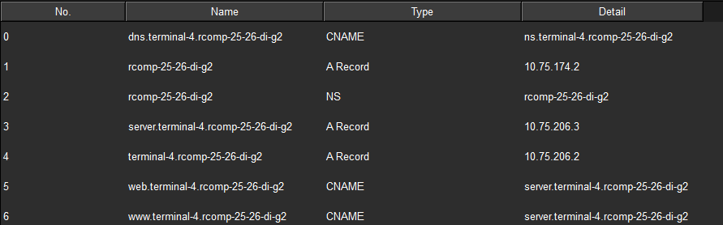

RCOMP 2025-2026: Project 1 Sprint 3 Member 1241229
=====

### Contents

1. [Dynamic Routing (OSPF)](#1-dynamic-routing-ospf)
2. [Local DNS and HTTP Services](#2-local-dns-and-http-services)
3. [VoIP Service Configuration](#3-voip-service-configuration)
4. [Static NAT Configuration](#4-static-nat-configuration)
5. [Static Firewall (ACLs)](#5-static-firewall-acls)

---

## 1. Dynamic Routing (OSPF)

In Sprint 3, the static routing table was removed to implement a dynamic routing protocol (OSPF). This ensures dynamic convergence and route exchange between the Campus Backbone and Terminal 4.

* **OSPF Process ID:** 1
* **Router ID:** 10.75.208.4
* **Backbone Area:** 0 (for Interface Fa0/0.797)
* **Local Terminal Area:** 4 (for Internal Subnets)

### 1.1. Advertised Networks

| Network Address | Wildcard Mask | Area |        Description         |
|:---------------:|:-------------:|:----:|:--------------------------:|
|   10.75.208.0   |   0.0.0.255   |  0   |      Campus Backbone       |
|   10.75.192.0   |   0.0.7.255   |  4   |    T4 Wi-Fi VLAN (807)     |
|   10.75.200.0   |   0.0.3.255   |  4   | T4 User Outlets VLAN (808) |
|   10.75.204.0   |   0.0.1.255   |  4   |     T4 VoIP VLAN (809)     |
|   10.75.206.0   |   0.0.0.127   |  4   | T4 DMZ Servers VLAN (810)  |

---

## 2. Local DNS and HTTP Services

A local domain was established for Terminal 4, and a secondary server was added to the DMZ to fulfill the HTTP/HTTPS service requirements.

* **Local Domain:** `terminal-4.rcomp-25-26-di-g2`
* **DNS Server IP:** 10.75.206.2
* **HTTP Server IP:** 10.75.206.3

### 2.1. DNS Resource Records

Below is a screenshot showing the configuration of the local domain and records on the DNS server (10.75.206.2):

---

## 3. VoIP Service Configuration

The Cisco IP Telephony service was established for Terminal 4. The router acts as the Unified Communications Manager Express (CME).

* **VLAN ID:** 809
* **Network:** 10.75.204.0/23
* **Default Router (Gateway):** 10.75.204.1
* **TFTP Server (Option 150):** 10.75.204.1
* **Terminal Prefix:** 4 (Valid Range: 4***)
* **Switchport Configuration:** Ports connected to IP phones have the access VLAN disabled and the voice VLAN 809 enabled.
* **Call Forwarding:** Dial-peers configured to forward calls to Terminals 2, 3, and 5.
---

## 4. NAT Configuration

To allow external access to the internal web services of Terminal 4 without exposing the private IP addressing of the DMZ, a Static NAT (Port Forwarding) was configured on the Router.

* **Inside Interface:** Fa0/0.810 (DMZ)
* **Outside Interface:** Fa0/0.797 (Backbone)

### 4.1. Port Forwarding Rules

| External IP (Outside) | External Port | Internal IP (Inside) | Internal Port | Protocol | Target Service |
|:---------------------:|:-------------:|:--------------------:|:-------------:|:--------:|:--------------:|
|      10.75.208.4      |      80       |     10.75.206.2      |      80       |   TCP    |      HTTP      |
|      10.75.208.4      |      443      |     10.75.206.2      |      443      |   TCP    |     HTTPS      |

---

## 5. Static Firewall (ACLs)

Traffic access policies were implemented using Extended Access Control Lists (ACLs) applied to the router's subinterfaces. The configuration strictly follows the 5 rules of precedence required for the Sprint 3.

### 5.1. Access Control Lists Strategy

| Precedence Rule             | Security Policy Description                                                                                                          | Implemented In |
|:----------------------------|:-------------------------------------------------------------------------------------------------------------------------------------|:---------------|
| **1st - Anti-Spoofing**     | Blocks internal T4 IPs arriving from the external backbone.                                                                          | `BACKBONE_IN`  |
| **2nd - ICMP Permitted**    | Echo requests and echo replies are always permitted.                                                                                 | *All ACLs*     |
| **3rd - DMZ Protection**    | Blocks all traffic to the DMZ except DNS (.2) and HTTP/HTTPS (.2 and .3). Traffic originating FROM the DMZ is permitted.             | `DMZ_OUT`      |
| **4th - Router Protection** | Blocks traffic directed to the router itself, excepting required services (DHCP, TFTP, SCCP on port 2000, OSPF, and NAT HTTP/HTTPS). | `ROUTER_IN`    |
| **5th - Pass-Through**      | The rest passes. General cross-network transit traffic is permitted.                                                                 | *All ACLs*     |

### 5.2. Interfaces Application
To enforce the strategy above, the ACLs were applied to the following subinterfaces:

* **`BACKBONE_IN`:** Applied on **Fa0/0.797** (Direction: **IN**).
* **`DMZ_OUT`:** Applied on **Fa0/0.810** (Direction: **OUT**).
* **`ROUTER_IN`:** Applied on **Fa0/0.807**, **Fa0/0.808**, and **Fa0/0.809** (Direction: **IN**).